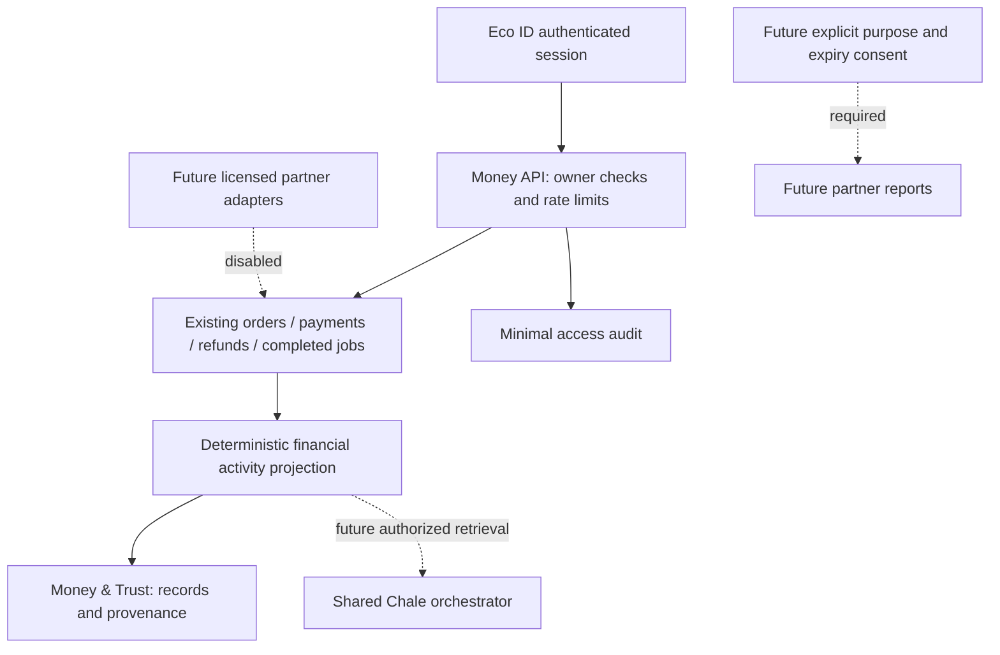

# Money & Trust: source audit and implementation sequence

Date: 2026-10-09. Scope: the existing repository, not a certification or production-readiness claim. The new Money & Trust directive is an expansion of the shared Eco ID architecture. This audit was completed directly after the three parallel reviewers stopped at account limits.

## Evidence inventory before the new financial module

| Component | Status | Source evidence and actual limits |
|---|---|---|
| Web application and navigation | BUILT | `src/modules/App.tsx`, `vite.config.ts`: React/Vite; page state, no general URL router. Most ecosystem cards use local sample data. |
| Eco ID/authentication | PARTIAL | `server/supabase-auth.mjs`, `/auth/supabase/session` in `server/index.mjs`: Supabase token verification and account bridge; local cookie sessions. Hosted recovery/revocation/MFA still need verification. |
| Provider onboarding and staff verification | BUILT locally | `server/providers.mjs`, `ProviderPortal.tsx`, scoped staff review routes: owner profile, revision checks, current approval before offers. No organization team tenancy. |
| Seller verification | PARTIAL | `seller_profiles`, `verification_requests` and staff routes: distinct seller scope; complete seller lifecycle needs further audit. |
| Marketplace | PARTIAL | `MarketplaceHub.tsx`, `/marketplace/*`, orders/items/fulfillment tables: listings, CSV, stock reservation, orders and fulfillment. Preview shopping UI also exists. |
| Paystack | PARTIAL / TEST ONLY | `/webhooks/paystack`, checkout and staff refund routes: signed callbacks and charge verification. Hosted journey unverified. Exact refund matching and staff reconciliation were hardened locally on October 10; hosted verification, durable processing and missing-ID recovery remain gates before external evidence certification. |
| Wallet / custody / ledger | PROTOTYPE / MISSING | `App.tsx` Wallet is an explicit demo; no custodial wallet or double-entry settlement ledger. Never relabel transaction totals as held funds. |
| Quick&Handi | PARTIAL | Jobs/offers/messages/status routes and `JobsBoard.tsx`: completed work is recorded; there are no job-payment or provider-payout records. Offer amounts are not earnings. |
| Waste-to-Money | PARTIAL | `WasteHub.tsx`: collection requests/provider application; no verified material weights, plant purchase or settlement network. |
| Opportunities | PROTOTYPE | `src/data/seed.ts`, `App.tsx`: sample opportunities; no authoritative funding/application integration. |
| Community/Creators | PARTIAL | `SocialHub.tsx`, social/media API and migrations; main feed still has device previews. Hosted storage/LiveKit remains provider-dependent. |
| Messages/notifications/support | PARTIAL | Job/social message permissions, notifications and support_reports exist in `server/index.mjs`; not a complete institutional complaints or remittance escalation system. |
| Maps | PROTOTYPE | Location labels/UI exist; no operational route/facility/corridor service. |
| Chale AI | PARTIAL | `server/chale-ai.mjs`: six bounded public/context/guide/diagnostic/draft tools and OpenAI Responses integration. No private financial retrieval, provider abstraction, lender decision or transfers. |
| Personalization | BUILT locally | `server/recommendations.mjs` and preference/signal routes: consented weights with pause/reset. Not autonomous foundation-model training. |
| Financial evidence, consent exchange, Trust Passport | MISSING | No lender disclosure, report provenance/expiry or partner authorization service. Existing generic domain_events/audit_logs are reusable but not an immutable financial ledger. |
| Remittance / MTN MoMo / banking / lending partners | MISSING | No configured adapters, approved corridors, contracts, real FX quotes or access scopes. Paystack commerce is not a remittance integration. |
| Database/deployment | PARTIAL | Eight Supabase migrations applied; API-only RLS posture. `server/web.mjs` and single-origin Render blueprint tested locally. Render resource setup and hosted flows not yet verified. |
| Operations/security | PARTIAL | CSRF, origin checks, durable rate-limit buckets, staff MFA gates, audit tables, private-storage adapter and headers exist. No completed restore drill, monitoring rollout or independent penetration test. |

## Immediate architecture

First addition: authenticated read-only account activity, clear test environment labels, integer minor-unit calculations, explicit exclusions for inconsistent records, account-change clearing and a distinct navigation entry. Completed jobs remain nonfinancial activity. No private activity goes to a model or partner in this slice. No money movement, financial score, guarantee, exchange rate or live balance is introduced.

Next dependencies, in order:

1. Payment/refund event identity, exact refund matching, late/duplicate/reversed settlement, retry/outbox and reconciliation invariants with provider fixtures.
2. Immutable evidence/report snapshots with source versions, environment and correction lineage; source verification must be an earned status.
3. Organization membership and tenant permissions before business teams or partner records.
4. Purpose-specific sharing grants, partner verification, scope/expiry/revocation and disclosure audit. Registering a partner must grant no data access.
5. Named remittance sandbox adapter and quote/transfer state machine. Mock rates must stay visibly simulated and impossible to submit to production.
6. Model-provider abstraction and separately authorized financial tools. Deterministic arithmetic stays outside the model; no underwriting or grant decisions.
7. Reviewed compliance package, hosted security/restore checks, partner contracts and explicit controlled-activation approval.

## Regulatory dependencies — preliminary, not legal approval

**DRAFT — REQUIRES QUALIFIED LEGAL AND COMPLIANCE REVIEW.** Owner: EcoVibes leadership, legal owner to be appointed. Version 0.1; Ghana-first; reviewed 2026-10-09 for engineering dependency planning only; not approved for launch.

- Bank of Ghana publishes requirements for [IMTO registration and operations](https://www.bog.gov.gh/news/guidelines-for-the-registration-and-operations-of-international-money-transfer-operators-imtos-in-ghana/) and [inward remittance services by PSPs](https://www.bog.gov.gh/wp-content/uploads/2025/08/NOTICE-NO.-BG-GOV-SEC-2025-25-UPDATED-GUIDELINES-FOR-INWARD-REMITTANCE-SERVICES-BY-PAYMENT-SERVICE-PROVIDERS-1.pdf). Counsel must determine EcoVibes' role, permitted counterparties/corridors and applicable licensing before an adapter is activated. A Paystack commerce integration does not establish remittance authority.
- Ghana's Data Protection Commission describes [registration and organizational compliance duties](https://dpc.gov.gh/for-organisations/). Financial sharing, third-party AI processing and cross-border transfers need a documented lawful basis, minimized fields, retention, subject rights and an approved processor/partner arrangement.
- Credit evidence versus credit reporting, AML/CFT responsibilities, consumer complaints, financial record retention and cross-border legal roles remain unresolved review questions. The requested 20-policy package is not yet drafted or approved. Do not claim this dependency note satisfies it.

Sources were checked on 2026-10-09. Page footers and related-news dates are not treated as instrument issue dates. No partner or regulator has been contacted.

## First slice delivered locally, 2026-10-10

The first addition described above is implemented: `server/money.mjs`, personal `/money/overview`, the lazy `MoneyTrust.tsx` screen, navigation and a shared Chale guide entry. Unsupported/contradictory records and unsafe numeric inputs are excluded, amounts are summed exactly and currencies are not converted. No new database migration or external disclosure was introduced.

Verification: 122 tests, production build, 44 provider/ownership/static-host HTTP checks and 15 mocked Chale HTTP checks passed. The desktop and phone guest views, home shortcut and sign-in link were reviewed in the browser. [Details and limitations](releases/2026-10-10-money-trust.md). The broader evidence/consent/partner/remittance inventory above remains unfinished; a Trust Passport preview does not change that status.
