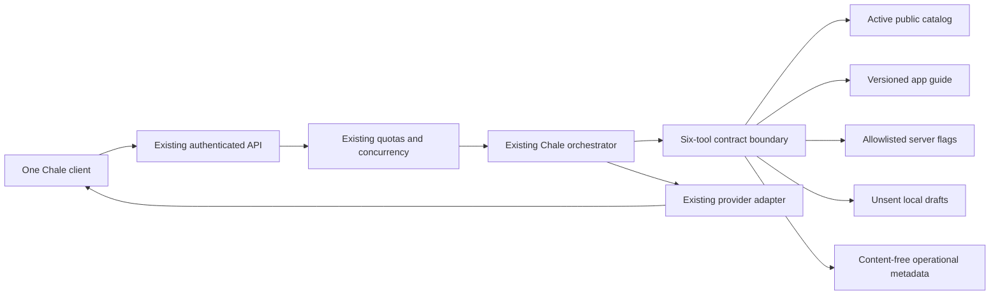

# Chale 2.0: central gateway audit and tool contracts
Updated 7 November 2026. This is a bounded implementation against the existing application, not certification of Chale 2.0 or the whole ecosystem.

## Baseline and authority
The isolated branch starts at verified PR39/main `56e0c2ebf83dfc2c89fccd0bc552691e4ae42b9b`. The primary workspace contains unrelated dirty work and is not a release candidate. The November 7 [founder directive](../directives/2026-11-07-chale-2-living-ecosystem.md) governs this stage; the [capability dashboard](../partner-readiness/README.md) remains the single platform readiness source.

Actual stack: React/Vite web client; one Node application API; PostgreSQL/Supabase in hosting and disposable SQLite for HTTP fixtures. Existing server/chale-provider.mjs owns operator-selected provider configuration, billing restrictions, timeout, concurrency and usage reporting. server/chale-ai.mjs owns orchestration; server/index.mjs owns session/CSRF/origin/rate gates and public catalog selection. No second assistant, database, model subscription or service was introduced.

Fresh read-only Render metadata confirms the existing ecovibes-api service uses main, runtime Free, Frankfurt, one instance and autodeploy off. Build plan metadata is separate from runtime plan. No new deployment was inspected or performed. The last verified deployed source is PR39; local changes and PR46–48 are not hosted acceptance.

## Evidence-based audit matrix
“Working and verified” below always states its evidence scope. The directive's labels are classifications, not permission to release.

| Area | Classification | Actual implementation/evidence | Remaining dependency |
|---|---|---|---|
| Central inference and provider abstraction | Working and verified, bounded; Security-sensitive | Existing Cloudflare Free grounded path; OpenAI tools, compatible, Ollama and Bedrock adapters in chale-provider.mjs. Historical genuine Cloudflare answers and current synthetic adapter tests. | Broader real-model/provider failure, language, current-fact and cost/latency acceptance; no paid fallback activation. |
| Authenticated API gateway | Partially working; Security-sensitive | Existing /ai/chat validates message/context limits; derives identity/learning flags on server, uses CSRF/origin and quotas. | PR24 recovery/browser/revocation/transaction-time gates and real Auth/clock/MFA acceptance remain open. |
| Tool contracts and execution | Broken availability reproduced; LOCALLY BUILT repair | Six existing tools extracted into a frozen shared registry with input/output contracts, scope/risk/confirmation/timeout/audit metadata. Ignored cancellation previously held the only inference slot indefinitely; bounded waits now release it. | Exact-source remote CI, independent review, explicit release approval, hosted regression. |
| General reasoning and prompts | Partially working | Existing shared instructions and page prompts; warm/everyday responses and deterministic greetings already implemented. | Representative Ghana/world, language, accuracy, uncertainty and adversarial model evaluations. No current web lookup is claimed by model memory. |
| Public guide retrieval | Partially working | Versioned JSON/keyword lookup and canonical client cards. This increment corrects obsolete unavailable-Messages and unsafe call-readiness guidance. | Other guide sections need capability-by-capability freshness review before broader agent use. |
| Public catalog retrieval | Working and verified in fixtures; Security-sensitive | Existing active public product/open-job selector and output field allowlist; same one-query callback contract and one-lookup limit. | Genuine nonempty hosted catalog and account-scope acceptance. Draft commerce publication/storage work is separate. |
| Private work-status projection | Implemented but unverified end to end; Security-sensitive | Existing authenticated /ai/work-status returns own/assigned job counts, outside model tools. Draft PR25 broadens the protected card. | Two real accounts/nonempty jobs/account switching and release compatibility. Never put these records in a public index. |
| Conversation UI and history | Partially working | Production panel uses bounded in-memory recent messages. PR46 compact layout and PR47 consented private saved history have exact green remote tests; separate unmerged drafts. | Independent review, migrations, real Auth/MFA/two devices, retention/erasure/backup and explicit release. Reuse these drafts. |
| Personalization vs memory | Partially working; confirmed memory Missing in inspected source | Existing launcher/theme/character preferences and opt-in recommendation flags. Saved history is not confirmed user memory. | Separate explicit memory approval, provenance, inspect/update/delete/export and account-isolation implementation. No automatic chat training. |
| Knowledge ingestion/RAG | Partially working in draft | PR48 admin Studio and one fixed Wikidata staged-update pilot; green remote CI. User review, draft creation and publication are separate. | Migrations/release/real admin acceptance; end-user cited retrieval, approved multilingual embeddings, freshness/withdrawal and licensed wider sources. pgvector capability is not an installed index. |
| Streaming | Missing in inspected gateway/client | Provider adapters request stream:false; UI receives one JSON reply. | Abort-safe streaming contract and client rendering/accessibility before enabling. |
| AI voice and person-to-person voice notes | Missing in inspected routes/client | Voice language preferences exist, but no completed speech-to-text/text-to-speech or voice-note upload workflow was found. Calling media is a separate system. | Separate permission, consent, storage, retention, provider budget and device tests. Do not treat a preference as operational voice. |
| Messaging/notifications | Partially working; deployed text | Existing accepted-friend records, bounded foreground polling, Saved/Received acknowledgments and notices. Founder reported two phones received text. | Physical receipt/bell follow-up deferred; background push, voice notes and broader notification reliability not accepted. Chale has no message-content tool. |
| Calling and realtime | Blocked; Security-sensitive | Existing LiveKit/public-live code plus preserved separate private consent/admission WIP; private legacy paths fail closed. Foreground polling is not background realtime. | Approved owned TLS/media/TURN, strict remote revocation, per-call/video consent and two-device/slow-network acceptance. No keys-only enablement. |
| Business Simple/Advanced | Partially working foundations; shared business engine Missing in inspected code | Existing jobs/orders/products/roles and MoneyTrust test-record overview; payment/refund adapters and events exist. No completed prepare/confirm sale/expense or shared Simple/Advanced ledger service found. | Authoritative domain commands, ledger/reconciliation and role/organization scopes before any AI mutation. Do not duplicate existing records. |
| Finance and consequential agents | Security-sensitive; incomplete | Existing test-only Paystack/order/refund verification, not unrestricted model tools. Unknown confirm_sale and forged identity are refused in new HTTP fixture. | Provider-approved sandbox, durable idempotency/audit/outbox, eligible payouts and reconciliation. Actual transfers remain disabled. |
| Optional 3D character | Partially working presentation preference | Existing tests retain chat when character hidden. Approved artwork/prototype is separate and not a production rig. | Rig/assets/GPU/device acceptance; must not become a gateway dependency. |
| Monitoring/deployment | Partially working | Existing release and browser workflows; new boundary HTTP test added to release checks. Operational tool events omit content. | Independent review/exact CI/approved deployment and hosted evidence. Logs are best effort, not durable financial audit. |

No duplicate central assistant/provider stack was found in the inspected paths. Earlier experiments and superseded branches remain preserved; they are not automatically deprecated or authorized to delete.

## ADR: keep one gateway and admit only bounded existing tools
**Context.** The application already has provider adapters, a six-tool orchestration loop and a free grounded path. Tool declarations and validation lived in the orchestration module. A catalog reader that did not settle after HTTP abort held the inference slot indefinitely. Model-side declarations alone did not validate returned result structure.

**Decision.** Extract declarations and policies into server/chale-tools.mjs. Both the tools path and the grounded catalog path use one execution boundary. Keep the actual handlers next to orchestration and public data selection in the existing domain/API. Do not add dependencies, migrations, private tools or provider configuration. Validate result shape and byte budget before updating cards or handing tool data to a model.

**Alternatives.** A new agent framework/service would duplicate functioning infrastructure and add cost. Moving business mutations into the existing public handlers would blur permissions and confirmation. Passing a cancellation option into the existing catalog callback would change its public API without ensuring the database driver supports cancellation. These alternatives are deferred.

**Consequences.** A stalled asynchronous reader no longer keeps Chale waiting indefinitely; late results cannot append cards. This does not preempt synchronous CPU work or force-cancel an uncooperative SQL statement. Database statement deadlines/cancellation and per-domain resource budgets remain distinct work. Private or consequential tools require a separately reviewed authenticated authorizer, confirmation and transactional command interface.

**Action items.** Review this increment; run exact remote CI after scoped public-source approval; integrate with PR46/47/48 through explicit compatibility checks; then build published-source cited retrieval through the existing model before expanding authority.

## Current contract and data flow

The Free Cloudflare/compatible/local grounded paths perform deterministic public retrieval before inference; they do not acquire model-directed mutation privileges. Tools mode retains six total calls, three model rounds, duplicate-result reuse and one catalog lookup per reply.

| Tool ID | Inputs | Outputs | Scope/required permission label | Risk/confirmation |
|---|---|---|---|---|
| search_ecovibes_catalog | query, max120 | query and max8 safe product/job summaries | public_active_catalog / public_catalog:read | Read only; no confirmation for read |
| search_app_guide | query, max120 | current guideVersion and max3 bounded cards | versioned_public_guide / public_guide:read | Read only |
| get_my_context | empty object | page/data mode and server-derived sign-in, language, opt-in flags; guideVersion | allowlisted_server_flags / safe_context:read | Read only; no identity/profile data |
| diagnose_ecovibes_issue | symptom, max120 | bounded guidance-only diagnostic and guideVersion | public guide/configuration booleans | Read only; not a live health probe or repair |
| draft_support_request | title max100, detail max1000 | draft status, local notice and real support destination | local_unsent_draft / local_draft:prepare | Separate actual support-form review/submission required |
| propose_improvement | title100, problem/benefit/experiment/risk500 each | unsent draft and Home destination | local_unsent_draft / local_draft:prepare | Separate actual implementation/publication required |

Permission labels describe the fixed policies; they do not confer account roles. Client/model user IDs, business IDs, roles, SQL and arbitrary tool names are not accepted. Existing handlers are server-bound; only six public/local tools are registered.

Every executed handler has a 5,000ms waiting budget, caller-abort propagation, input JSON budget8KiB and output JSON budget32KiB. Schemas reject extra fields and wrong types, constrain enum/status/destination/version, nested structure, string and list sizes. Catalog fields are sanitized before validation. No failed result is added to response cards. Errors exposed to the model are safe codes and “do not invent a result”; raw handler errors are excluded.

Terminal events contain only toolId, outcome, durationMs and registryVersion; the existing API logger adds event, level and time. No query, result, user/account/business ID, chat, credential or media content is logged by this callback. Rejected malformed model calls, deduplicated calls and orchestration-limit responses can be refused before a handler runs; they are not claimed as separate execution audit events. The logger is best effort, with no new retention infrastructure or durable action log.

## Compatibility, operations and costs
- The six model declarations and public catalog callback signature are preserved. Strict output rejection and bounded tool waiting are deliberate behavior changes.
- No migration, new schema, provider configuration, API response envelope or application fee changed. No new scheduler, agent or network source was added.
- PR47 saved history and PR48 knowledge updates are not included. Their independent review/migration/release gates stay open. PR24 recovery security compatibility is not inferred from this no-schema delta.
- The canonical Messages guide now describes deployed accepted-friend text and received acknowledgments, not read receipts. Private calling remains unavailable. All four visible guide steps preserve the job-conversation shortcut.
- This registry adds no provider subscription/embedding bill. Existing free-only policy and configured40 member/guest allowance remain; guests still share the trusted-network bucket. Per-minute/global/capacity and failed-attempt accounting are retained.
- No cache of private content, long-term memory, browser storage, production data or chat-training dataset is introduced.
- Release requires independent source/security review, exact-source remote CI, explicit merge/deployment approval and scoped hosted checks. There is no new public feature flag; existing model/guide availability remains the rollback/disable boundary.
- A scoped code revert is schema-compatible because this increment adds no schema. It must not revert unrelated auth revocation barriers or other intervening releases. No production rollback drill occurred.

## Next dependency-ready increment
Integrate bounded retrieval of **published, unexpired, approved public knowledge** from PR48 into the same gateway, with source/version citations and adversarial freshness/withdrawal tests. Keep private work tools and confirmed memories separate until their authorization/consent contracts and real-account gates pass. Streaming, voice, business execution and agent expansion remain later stages, not implied by this registry.
