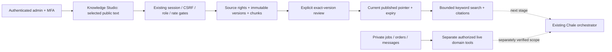

## 7 November 2026 — approved public-source update pilot (local)
LOCALLY BUILT on the existing Knowledge Studio foundation; unpublished and disabled in production. One fixed Wikidata Q117 country-profile adapter has a successful bounded real HTTP probe. This is public structured geography metadata, not a news feed, popularity service or a complete African language corpus.

The existing API uses durable source jobs, expiring leases, change fingerprints, conditional requests, retry/backoff, versioned staging and admin review. Administrator approval to fetch is separate from exact-text draft import and canonical publication. No private account content enters the public-source request. Existing Chale model/provider, quotas, private tools and character settings remain independent.

New API: GET /api/v1/ai/knowledge/sync; POST /sync/:key/settings, /sync/check, /sync/:key/apply. Existing session/staff/MFA/CSRF/origin/no-store/30-per-minute boundary is reused. Fixed registry keys accept no URL or account selectors. CHALE_KNOWLEDGE_ENABLED and CHALE_KNOWLEDGE_SYNC_ENABLED must both be true and both schema markers present; defaults remain off.

ADR-K2: reuse the existing modular monolith and database. A completion-scheduled 60-second wake checks one due approved source; successful reads wait24hours. PostgreSQL transaction advisory locks serialize brief queue changes; network fetching happens outside transactions, with30-second leases. Local overlap shares one check, cross-worker checks share durable leases. Pausing invalidates late fetches; expired fetch/import leases cannot acknowledge completion. No new cron service, job broker, vector DB, paid model or resource is created. Render Free sleep means no exact wall-clock synchronization guarantee.

External request: fixed HTTPS Wikidata API for Q117 labels/descriptions in en and available tw, descriptive User-Agent, no cookies/credentials/user text, no redirects,5-second absolute timeout,128KiB actual response cap. Entity/revision/language/text validation strips unrelated claims. Public etag/modified validators are bounded;304 requires a requested validator. Busy/failed reads use15-minute exponential backoff up to24hours and honor bounded Retry-After up to7days. Error codes are allowlisted, no raw provider body in UI/log/audit.

Rights: only Wikidata structured entity data from [Q117](https://www.wikidata.org/wiki/Q117) is in scope. [Wikidata Licensing](https://www.wikidata.org/wiki/Wikidata:Licensing) declares structured data CC0; article text and images are excluded. [Data access](https://www.wikidata.org/wiki/Wikidata:Data_access) and [API etiquette](https://www.mediawiki.org/wiki/API:Etiquette) informed the request limits. Public availability alone never grants rights to other sources. No Ghana-language accuracy claim is established by a Twi label.

Three additive tables: knowledge_sync_jobs (approval/schedule/lease/status), knowledge_sync_snapshots (immutable staged public text with7-day expiry) and knowledge_sync_events (append-only redacted actor/event trail). Existing canonical knowledge_sources/versions/chunks/events remain the publication source of truth. Draft save and queue acknowledgment are separate transactions: a response-loss or settings race can leave a saved draft; feedback says to inspect source history. Stable source ID plus exact text/expiry reuse prevents duplicate canonical versions. No publication pointer changes automatically. Reviewed rollback/withdrawal/expiry still use canonical services.

Limits: one registry source,50 cache snapshots,10k audit rows, existing20 sources/10 versions/20k characters. Expired cache text is pruned on the next enabled worker check, not continuously while the feature is off. Canonical immutable history retains its own retention rules. Ten canonical versions remain an explicit pilot limit, so indefinite unattended operation is not promised. Legal erasure, audit retention and capacity approvals remain release gates.

Cost: tests added0 model/embedding calls,0 paid services and GH₵0 platform fees. Only bounded metadata HTTP and existing DB/API capacity are used; no guarantee of permanent free upstream availability. At one unchanged source, successful checks are at most roughly one per awake24-hour cycle plus bounded retry attempts; API sleep can delay them. Worst configured50×20k×4 UTF-8 cache bytes≈4MB text before row/index overhead (estimate, not measured capacity). Existing core DB capacity has priority.

Final local evidence:605/605 tests in47files/74.99s; TypeScript/build1688; audit0/security8; existing Studio HTTP14 and PG17.10/36 plus sync HTTP12 and PG17.10/46 pass. Built local synthetic admin consent→fetch/stage→reviewed draft→reload→pause passed;390px viewport/document390px, Studio356px, no horizontal overflow. Source text was synthetic in UI/HTTP, the live source probe was separate. Screenshot was observed but local screenshot-file save failed EPERM; do not claim a saved Studio screenshot or physical-device evidence.

Review reproduced/fixed an old-account refresh hiding the new panel and an expired import lease claiming completion; both RED0/1 are retained. Initial unit16/1 control-character fixture, focused27/3 stale-copy/unsupported matcher errors and test-only TS mock typing failure are retained, then final605 green. No assertion/deadline/worker/isolation limits were weakened. This is author review, not independent approval.

Proposed migration20261107064239 SHA256 e7637431eab0d1d316c06b1d46c8d9b137b7534f7e0eb890e1088b2e538c7a00 is UNAPPLIED. Parent20261106184616 is also UNAPPLIED. Rollback disables sync first and retains canonical versions/audit; do not remove any separately introduced authentication barriers. Public publication of this queue/foundation, independent review, exact remote CI, current-main/recovery compatibility, real admin/MFA/unauthorized devices, measured capacity/retention/backups, and explicit migration/merge/deployment approval remain open. No production/provider/schema change occurred. End-user cited RAG, embeddings/pgvector, larger licensed source coverage, confirmed user memory, language/model evaluation, broader agents and fine-tuning remain incomplete.

# Chale knowledge engine: verified audit and delivery stages
Date: 6 November 2026. Status: stage1 LOCALLY BUILT; not deployed. Production provider/configuration unchanged.

## Verified baseline
- Existing React/Vite client and Node modular monolith; shared PostgreSQL API with local SQLite test adapter. No replacement application or service.
- Fresh public GET /api/v1/ai/status returned configured:true, cloudflare-free, @cf/meta/llama-3.1-8b-instruct-fp8-fast, grounded mode,40 member/guest daily, paidFallback:false, free-tier-only, everyday_and_ecovibes. This verifies configuration, not current answer quality or capacity.
- Read-only Supabase metadata: project poscxeapsaxuahausmoc healthy/PostgreSQL17.11.0.002,44 public base tables. No knowledge tables. vector0.8.2 available but NOT installed; pg_cron/pgmq also not installed. Do not describe pgvector or scheduled synchronization as already operating.
- Chale already has public guide/catalog retrieval, bounded tool/provider adapters, canonical app procedures, safe context, numerical usage logs and public updates. Existing own-work service has narrower authorization; draft25 expands explicit private status access but is not part of this branch.
- No shared public vector index, long-term conversation memory, document ingestion or fine-tuning pipeline was found. Recent messages remain in component memory and bounded request context. Recommendation preferences/signals are separate, opt-in and server scoped.
- Current six tools: app guide, diagnostic guidance, safe context, public catalog, support draft and improvement draft. Critical transactions remain server-authoritative; Chale cannot book/pay/message/approve arbitrary records.
- Existing requireStaff enforces database-derived staff membership and production aal2. Normal/support/trust roles must not become knowledge administrators.
- Old docs/chale-ai.md described app-only scope and earlier quotas. Source/fresh status supersede that stale description; documentation corrected in this increment.
- Existing privacy, recovery, private-work, profile, GPS and commerce drafts remain independent. Knowledge work must not make them operational by implication.

## Stage1 implemented scope
Admin-only Studio under EcoVibes ID, using existing session, CSRF, origin, rate limit and production MFA gates. Only bounded selected .txt/.md files or pasted text; explicit public reuse/privacy attestation before server storage. Selection alone does not upload. No PDF/OCR/archive/URL fetching, contact access or AI transmission.

Four additive API-only tables: knowledge_sources, knowledge_versions, knowledge_chunks, knowledge_events. Stable IDs, immutable text/hash/version history, chunking, optimistic source revision/transaction lock, explicit reviewed publication, reviewed rollback, immediate withdrawal and expiry exclusion. Existing server database transaction service is reused. Logs/audit events omit document bodies and search queries.

Admin preview search supports Unicode keyword normalization, category/language/region filters, bounded200 candidate ranking/three distinct sources, source/licence/attribution/hash/version/checked/expiry citations and explicit truncation. This is NOT semantic/cross-language search, factual validation, continuous ingestion or end-user RAG. General Chale answers are unchanged in this stage.

API base: /api/v1/ai/knowledge. GET/POST /sources; GET /sources/:id; GET /sources/:id/versions/:version; POST /sources/:id/versions, /sources/:id/publish, /sources/:id/withdraw; GET /search?q=... with optional language/category/region. All routes are admin only and no-store. Unknown account selectors/fields are rejected. The sole operator gate is CHALE_KNOWLEDGE_ENABLED=true; default false; missing migration fails closed. It must remain false in production pending release approval.

Limits:20 sources,10 versions each,20,000 characters/document,1,200-character chunks,50-source pagination,10-second UI requests,30 knowledge requests/minute/account. Immutable retries prevent duplicate source creation. Case folding is Unicode-aware; this is not proof of Twi/Ga/Ewe translation quality. Source metadata is immutable in this pilot; new metadata needs a new reviewed source. Withdrawal excludes retrieval but retains version text/history: legal-erasure/redaction/retention operations are a release requirement before unrestricted uploads, not implemented here.

## Architecture decision ADR-K1
Status: proposed production rollout; accepted local implementation.
Decision: extend modular monolith, existing PostgreSQL and staff/session boundary. Prove public provenance/version/publication control with deterministic retrieval before adding embeddings.
Options: (A) existing DB + keyword foundation: no extra service/model cost, simple tests, limited meaning/translation recall; selected. (B) Supabase pgvector hybrid retrieval: same data plane and useful semantic recall, requires extension migration, embedding licence/destination/budget and native language evaluation; next. (C) separate vector database/agent service: duplicated authorization/operations/cost without measured need; rejected.
Consequences: no new provider or automatic content channel yet. Later consumers must recheck current publication/expiry before answering and must not cache withdrawn content as current.

## Dependency-ordered implementation and acceptance
1. This increment: Studio lifecycle/storage/permissions/keyword preview/migration and tests. Complete only the evidence actually recorded in the release receipt.
2. Safe public-source adapters: fixed allowlisted APIs, per-dataset rights records, contactable User-Agent, bounded timeout/bytes/pages, ETag/Last-Modified/hash change detection, failure/next-attempt metadata, staging before review. Add persistent leased jobs with dedup/backoff to existing DB. Approved worker/cron capacity and terms before enabling. Never poll from every chat or fetch user-supplied URLs. Expiry immediately fails closed even while sync is down.
3. Cited RAG through existing provider: retrieval evidence is DATA, never instructions; server-generated citation IDs/links only; answer-to-evidence checks, abstention on unsupported/current facts. Add citations to existing UI. Public sources only. Private tools retrieve from authorized live domain services and are not indexed. Test prompt injection and fake citations with a synthetic provider, then bounded approved real-model evaluations.
4. Multilingual embeddings/hybrid retrieval: verify BGE-M3 licence and chosen hosted destination, evaluate Ghana languages against curated native-speaker gold sets, obtain existing-capacity/operator approval. Proposed pgvector vector(1024) chunks keyed by source/version/model/dimension and content hash; full-text simple config plus language-aware tokenization and reciprocal rank fusion. Queries enforce published/current/unexpired/allowed-language/region BEFORE result use. PostgreSQL API-only RLS remains. No embedding API or vector schema is deployed by this stage.
5. Ghana/Africa curation: native speakers and domain reviewers establish actual Ghanaian language/culture/agriculture/recycling/local-service gold sets with documented rights, regional applicability and update dates. Economic observations include reference period/units/revisions, not live-price claims. High-stakes sources need stricter TTL and expert review.
6. Operational intelligence: accept draft25/private selector boundaries and real two-account/nonempty/switch/provider failure/quotas first. Register each future order/booking/collection tool with explicit permissions, output schema, idempotency/confirmation where consequential and sensitive-field exclusion.
7. Ownership pathway: optional licensed open-model fine-tuning only after measured RAG gaps, curated dataset consent/provenance/deletion records, held-out evaluation and compute/cost approval. No automatic private-conversation collection, no user conversations as training data by default, no claim of model ownership merely from prompting.

## Source and licence verification (not activated integrations)
| Candidate | Verified licence/access fact | Allowed next step / unresolved gate |
|---|---|---|
| [Wikidata structured entities/lexemes](https://www.wikidata.org/wiki/Wikidata:Licensing) | Structured main/Property/Lexeme/EntitySchema data CC0; other namespaces use a different licence. | Small country/geography/language metadata pilot with provenance; not whole-site crawling or guaranteed truth/native-language coverage. Follow [API access policy](https://www.mediawiki.org/wiki/Wikimedia_APIs/Access_policy) and [rate limits](https://www.mediawiki.org/wiki/Wikimedia_APIs/Rate_limits). |
| [World Bank datasets](https://datacatalog.worldbank.org/public-licenses) | Default World Bank-produced open datasets CC BY4.0; exceptions/microdata restrictions exist. Attribution and changes/translations must be recorded. | Verify exact chosen dataset/indicator terms and reference periods before Ghana economic/education/agriculture import. Do not ingest restricted microdata. [Official Indicators API](https://datahelpdesk.worldbank.org/knowledgebase/articles/889392). |
| [OpenAlex API](https://help.openalex.org/api/) | Metadata CC0; API casual usage has bounded free access, accounts/paid usage have separate budgets. | Scientific discovery metadata only. Papers/full text/images need their own licences. No account/key/spending or automatic fetch enabled. [Current access/pricing](https://help.openalex.org/access/pricing/). |
| EcoVibes canonical guides/policies | App-owned checked-in material; features must match verified deployed availability. | Curate public documentation only; do not bulk-index repository files, secrets or draft capabilities as production facts. |
| Ghana language/community/scientific full-text corpora | No blanket commercial-use approval established for a specific corpus in this session. | BLOCKED for ingestion until item-level rights, consent, quality and native-language evaluations. Public visibility is not permission. No noncommercial/unknown source is admitted by this pilot. |

## Evaluation protocol
Automated lifecycle/security tests: guest/member/support denial; admin/MFA boundary; CSRF/origin; malformed/oversized input; licence/private attestation; stable retries; stale/concurrent edits; draft visibility; version rollback; withdrawal; expiry; citation provenance; restart and no content in logs. PostgreSQL checks exact migration, RLS and runtime privileges/immutable tables. UI tests save failure/draft retention/exact-version consent/account unmount.

Next model evaluations use a held-out multilingual factual and adversarial set; record question ID, expected sources/reference dates, language reviewer, supported-claim/citation precision, abstention, retrieval recall, injection success rate, private-field leakage, p50/p95 latency and numerical tokens/neurons. Never label keyword matching as general factual accuracy or native-language quality. Model/citation/linguistic outcomes have NOT been measured in stage1.

## Cost and deployment requirements
- Stage1 adds no embedding or model calls, paid service, resource, subscription or platform fee. Local development uses existing dependencies and disposable databases. Incremental provider spend in these tests: US$0.
- Existing [Cloudflare Workers AI pricing](https://developers.cloudflare.com/workers-ai/platform/pricing/) lists10,000 free neurons/day, reset00UTC; limits fail when exhausted on Free. Existing Chale40-per-account is an app quota, not a guarantee of global model capacity. No paid fallback or upgrades.
- [Supabase Free](https://supabase.com/docs/guides/platform/billing-on-supabase) lists500MB/database. Actual remaining capacity/egress/backup envelope is unverified; do not promise unlimited free RAG. Pilot limits allow20×10×20k=4million UTF-16 code units of version text. UTF-8 text, copied chunks and normalized search text can approach36MB before indexes/row overhead (estimate, not a measured bill). Operator must measure remaining storage before production enablement. Existing platform data has priority.
- Proposed [BGE-M3 model](https://developers.cloudflare.com/workers-ai/models/bge-m3/) is a candidate, not enabled. [Upstream model card](https://huggingface.co/BAAI/bge-m3) declares MIT,1024-dimensional multilingual embeddings; this does not prove Ghana-language performance. Reusing Free inference consumes the SAME finite neuron budget; self-hosting needs measured RAM/CPU/latency and owner approval, not a new GPU by default.
- Vector raw storage estimate:1024 float32≈4096bytes/chunk;10k chunks≈39MiB BEFORE metadata/text/indexes/backups. This is an estimate, not a bill or capacity benchmark.
- Required release gates: independent source/security review; exact CI; approved additive migration; verified capacity/retention/erasure/backup plan; real admin MFA and two unauthorized accounts; mobile selected-file/cancel/failure checks; explicit merge/deploy approval. No production schema/provider change in this session.
- Rollout: keep feature default off, apply reviewed migration through existing authorized workflow, deploy exact reviewed source, verify gate/admin-denied/member-denied/no-store and one synthetic or owner-approved public document, then enable only after approval. Rollback first disables CHALE_KNOWLEDGE_ENABLED. The isolated branch can return to its56e0c2eb baseline while retaining tables/immutable history. A later combined release needs its own compatible rollback, preserving any separately introduced authentication barriers and other migrations; this baseline is not universal rollback permission. No destructive down migration.

