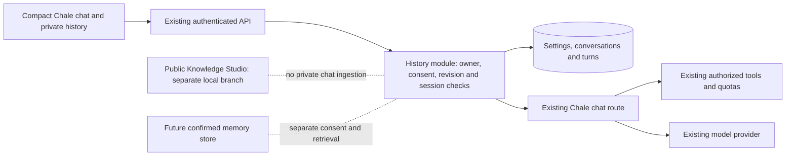
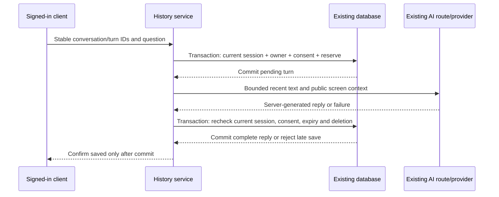

# Chale conversation history and memory boundary

Current snapshot: 6–7 November 2026. Implementation branch: `codex/chale-history-20261106`, based on local compact-chat checkpoint `8f330e3b` (the verified PR46 code tree). This is a private local increment, not a production release. The canonical request is [the founder's ultimate directive](../directives/2026-11-06-chale-ultimate-master.md).

## Verified baseline and scope

The existing React/Vite web app, Node modular API and PostgreSQL/Supabase architecture are retained. The deployed provider remains Cloudflare Free with the existing provider abstraction, model budget, public app-guide and permission-checked tools. At audit time, recent chat existed only in component memory. Recommendation preferences and language choices already existed, but neither was a durable AI memory store.

P1a now implements private account chat text and its management. P1b will implement separate user-confirmed memories and the actual memory overview. No private history is copied into the separate public Knowledge Studio or a vector index. No automatic training is introduced. PR24 recovery/security, PR25 work tools, PR29/30 media/privacy, commerce drafts and the separate local Knowledge Studio commit `77b21a14` are not silently merged into this branch.

## Architecture decision ADR-CH-002

Use three purpose-specific tables inside the existing API/database, rather than reuse friend-message rows or create another identity/provider service. Conversation history and social messages have different consent, lifecycle and inference semantics. Reuse existing users, sessions, CSRF/origin validation, error normalization, transactions and AI route. No new infrastructure, library dependency, model provider, vector extension or queue is required.

The provider call never runs while holding SQL locks. PostgreSQL history writes use a bounded pilot-wide advisory lock; session/user rows are locked during mutations to serialize with revocation. This is not a scalable distributed history service or proof of all PR24 recovery barriers.

## Data model and controls

| Table | Purpose | Ownership and mutations |
|---|---|---|
| `chale_history_settings` | Explicit saving preference and consent version | One row per existing user; a changed consent version disables saving until reviewed again. |
| `chale_conversations` | Stable ID, title, pin/archive, revision, timestamps, expiry and deletion identifier | Existing user foreign key; server owner scope; revisioned metadata; no runtime parent DELETE. |
| `chale_turns` | Question, immutable public context, server reply, order and processing state | Composite conversation/owner foreign key; client cannot supply assistant text; limited response/status UPDATE and text DELETE. |

The generated proposed migration is `20261106220412_chale_conversation_history.sql`; it is UNAPPLIED. RLS is enabled and direct PUBLIC/anon/authenticated/service_role access is revoked. The trusted API runtime is allowed only the stated operations, and every application read/write is owner-bound. RLS for that server role does not independently derive the owner; application checks remain essential.

A proposed narrow `UPDATE(token_hash)` grant on existing sessions permits PostgreSQL row locking. It is not permission to expose session hashes to clients or models. Hashes stay inside the request-bound server context. This privilege change requires independent review and explicit migration approval.

## Mode and privacy contract

- **Session chat:** existing in-memory behavior; no new account history write.
- **Saved chat:** available only after the account saving choice and server feature gate; only newly submitted questions/replies are stored.
- **Temporary Chat:** explicit current-chat mode; no history or memory writes and no recommendation feedback/profile-learning lookup. Existing authorized platform tools may still answer an explicit question through their existing boundaries.
- The Temporary label stays visible alongside success/error notices. Changing the normal saving preference does not convert an explicit Temporary Chat into a saved chat.
- Temporary choice survives closing/reopening Chale in the current page. A full page reload starts a new session/chat according to the account preference; it does not resurrect temporary text.
- History saving, future memory consent, device permissions, upload/sharing and model-training consent are separate. Saving history is not model-training consent.
- Chat/draft text is not written into localStorage, analytics, public discovery or audit content by this increment. Privacy warnings still ask users to keep secrets out of chat.
- History snapshots display dates and a warning that old news, account answers and actions are not current verification. Structured private cards are not restored from old text.
- Disabling saving preserves access to existing chats until deletion/expiry. Delete-all is separately confirmed. Deleting history does not delete separate future memories, provider records or backups.
- Expiry is fixed at 30 days after creation. Access excludes expired rows immediately; startup and hourly cleanup physically remove expired text while the feature is enabled. If disabled/offline, purge waits until the service resumes; backup/provider retention requires separate operational acceptance.
- Minimal owner/ID/timestamp deletion records remain to reject stale retries. Their longer retention and capacity require approval before production; no blanket erasure or legal-compliance claim is made.

## API contract

All paths below are under the existing `/api/v1/ai/history` boundary. Private responses inherit no-store; writes require the current CSRF token and allowed origin.

| Method/path | Meaning |
|---|---|
| GET/POST `/settings` | Read/change versioned saving consent. |
| GET/POST `/conversations` | Paginated list or stable duplicate-safe creation. |
| POST `/search` | Owner-scoped literal title/question/reply search; private search text stays out of URLs. |
| GET `/conversations/:id` | Last 20 turns, ordered, with an earlier-turn cursor. |
| PATCH `/conversations/:id` | Rename, pin, archive/unarchive using exact revision. |
| DELETE `/conversations/:id` | Confirmed text deletion and non-resurrection identifier. |
| DELETE `/conversations` | Confirmed owner-only delete-all. |
| GET `/conversations/:id/export` | Actual single-chat JSON export. |
| POST `/conversations/:id/turns` | Stable turn command through existing AI route. |

The client supplies only a UUID, bounded question, page and data mode. It cannot choose another owner, submit assistant text or fabricate a model response. At most three prior complete model turns are retrieved from the same chat, with 1,200-character per-message clipping and 6,000 total characters. There is no automatic cross-chat retrieval or summary generation yet.

Complete retries return the saved text without a new model request. A pending, failed or uncertain turn ID is never automatically redispatched. Context field ordering is normalized before idempotency comparison. A competing question is rejected while the first is processing. Pending attempts older than 120 seconds display as interrupted; their late replies cannot become successful saves. Archived chats must be unarchived before continuing.

Current session, saving consent, deletion and expiry are rechecked before final persistence. Lost responses say saving is unconfirmed and direct users to History. History-only failures do not falsely label the model unavailable. Deletion or logout during model processing prevents late answer storage. Already-dispatched provider work cannot be undone by this local database control.

## Bounded pilot capacity and cost

No new paid service or real model call was made to test this increment. Existing 40-question member/guest daily limits and shared/minute/free-capacity accounting remain. Guests still use the existing trusted-network bucket. Saved greetings use the existing zero-model route; replayed completed turns use zero new inference.

Bounds: 30 active chats/account; 200 turns/chat; 500 retained turns/account; 1,000 total retained turns; 300 retained conversation IDs/account and 10,000 total IDs; 20-row list/message pages; 30 history requests/minute/account; 30-day chat expiry. These are honest pilot bounds, not a promise of unlimited history. Temporary Chat remains available when saved-history capacity is full, subject to normal AI allowance.

At the maximum question/reply/context lengths, 1,000 turns could contain approximately 42.6 MB of UTF-8 text before row/index/WAL/backups and metadata. This is an upper-bound planning estimate, not a measured hosted storage bill. Actual Supabase headroom, backup growth, latency under load and provider throughput need acceptance. A single API timer on the existing service is used; no external cron or paid worker is activated.

## Verification boundaries

Automated tests use synthetic accounts, intercepted fixture model replies and disposable SQLite/PostgreSQL. They verify persistence, restart, same-account second session, other-account denial, consent, quotas/error routing, duplicates, revision conflicts, deletion, expiry, runtime grants and session revocation during processing. They are not genuine Cloudflare reasoning, real Supabase MFA/recovery, real founder-phone acceptance, physical GPS or production security certification.

Actual built-browser checks at 390×844 covered consent, save, reload, restored timestamps, Temporary exclusion, rename/pin, JSON export, archive/unarchive, account switching and confirmed deletion. A native screenshot showed a readable compact panel with document width equal to viewport width. The success-notice privacy-label defect was found and fixed, then verified in the rebuilt browser. A post-reload sign-in locator attempt found no matching field because session loading had completed; the next snapshot confirmed the existing synthetic account. No credentials from real accounts were used. A later author-review RED reproduced an export completing after account switch; generation/owner/abort checks now reject stale history responses before export or other client effects. Final focused/full/build checks cover it; no second browser pass is claimed for that helper-only fix. Native screenshots were inspected in tool output; no screenshot-file artifact is claimed.

## Ultimate directive implementation matrix

These are deliverable states, not whole-app readiness.

| # | Deliverable | Status and evidence/next gate |
|---|---|---|
| 1 | Current-state audit | Verified for inspected code, documented production metadata and this scope; wider real-user quality remains unverified. |
| 2 | Architecture | Partial: diagrams/ADR/API/privacy/cost in this document; advanced cloud architecture remains design. |
| 3 | Model gateway | Existing provider abstraction retained; broader real-model benchmarks and fallback acceptance open. |
| 4 | Persistent conversation history | LOCALLY BUILT/tested P1a; unpublished, migration/review/CI/real accounts/release open. |
| 5 | Personal memory | Not started in code; separate P1b next. |
| 6 | What do you remember about me? | Not started; must query actual authorized memory records. |
| 7 | Memory management | Not started; history management is not memory management. |
| 8 | Personalization | Existing opt-in ranking/language primitives; confirmed long-term preference retrieval missing. |
| 9 | Cross-conversation intelligence | Manual private text search exists locally; automatic selective memory retrieval/summaries missing. |
| 10 | Secure database changes | Proposed three-table migration passes disposable PG; hosted UNAPPLIED and review/approval required. |
| 11 | Knowledge Engine/RAG | Separate local public library foundation; embeddings/end-user cited RAG/sync missing. |
| 12 | Knowledge Studio | Separate local `77b21a14`; not included/deployed here. |
| 13 | Live agents | Existing narrow tools retained; full authorized cross-pillar agents and action acceptance incomplete. |
| 14 | African languages | Existing language choice; licensed corpus/native-speaker quality acceptance missing. |
| 15 | Multimodal | Existing optional presentation/media primitives; Chale voice/vision/media AI integration not implemented here. |
| 16 | Learning Lab | Not started as a working admin/evaluation UI. |
| 17 | Model evaluations | Historical bounded model checks; no new real model-quality benchmark in this increment. |
| 18 | Cost/performance | Pilot caps and text estimate documented; hosted load/storage and model costs unverified. |
| 19 | Security evidence | Local isolation/CSRF/origin/revocation/RLS/dependency checks; independent review and wider gates open. |
| 20 | Deployment verification | No deployment; this local candidate has no remote CI or hosted acceptance. |
| 21 | Production readiness | Incomplete; separate dashboard remains authoritative. |
| 22 | Model independence | Optional later curated/licensed open-model evaluation; no training or ownership claim. |
| 23 | EcoVibes AI Cloud | Future design only; no service or infrastructure created. |

## Rollout and next smallest increment

Keep `CHALE_HISTORY_ENABLED` absent/false until independent source/security review, exact-source CI (including new HTTP/PG scripts), supported account/recovery compatibility, capacity/retention/backups and real two-account/device acceptance. Production remains the previously verified PR39 snapshot; there was no live audit or deployment in this history increment.

After explicit migration approval, apply the additive migration and verify role grants/marker. Publish only an approved reviewed candidate, require green main checks and an explicit release approval, then enable the feature with staged hosted acceptance. Disable the feature to stop new history access/writes if needed; retain the tables/deletion identifiers and preserve any security barriers from separately approved recovery work. No destructive down migration. Any combined release must use a guard-preserving baseline; old code that ignores future recovery barriers is not a compatible rollback.

Next P1b: an independently consented, owner-scoped confirmed-memory record with provenance, update/delete/export and a truthful memory overview. No inference from private conversations or operational records without explicit consent. Add retrieval only after deletion, contradiction, Temporary Chat and cross-account tests exist. Do not begin large model training, multimodal expansion or autonomous commerce before these controls and underlying transactions work.

