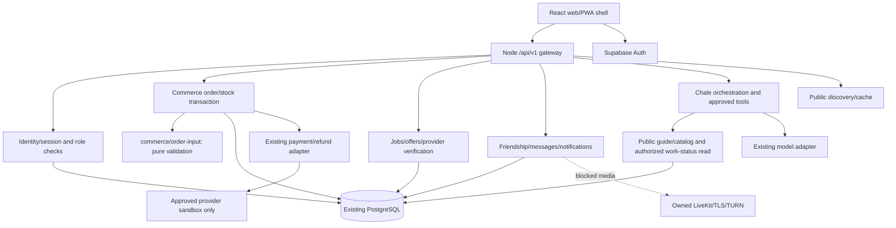

# EcoVibes system architecture

Audited 5 November 2026 against released main56e0c2eb, isolated branch codex/architecture-commerce-20261105, checked-in source/migrations and read-only Supabase metadata. This is the architecture baseline and target, not a claim that all target capabilities are operational. Current production acceptance remains in [the readiness dashboard](../partner-readiness/README.md).

## Deliverable map

| Deliverable | Location |
|---|---|
| High-level/current-versus-target architecture | This document |
| Domain boundaries, module dependencies and data flow | This document |
| Entity relationship model, persistence and retention | [Data model](data-model.md) |
| API, events and Chale tools | [Contracts](contracts.md), generated api-inventory.json |
| Security, authorization, deployment and rollout | This document and data model |
| Architecture decision | [ADR0001](decisions/0001-modular-monolith.md) |
| Scale/cost, technical debt and migration order | This document |
| Evidence-based implementation matrix | [Matrix](implementation-matrix.md) |

## Verified current stack

- React19.3/TypeScript7/Vite8.3.5 web client, manifest and service-worker assets; no implemented native mobile client was found in this checkout. Mobile/PWA installation and hardware acceptance are distinct.
- Node26.12.1 HTTP application. server/index.mjs still owns routing, database connection/transactions, authorization and many inline business operations. Existing service modules include providers, people-friends, direct-messages, money, paystack-refunds, recommendations, Chale and public discovery.
- Supabase PostgreSQL17.11.0.002 was reported by project metadata;44 public base tables and12 migration-history records were inspected without reading user rows. SQLite is an isolated local/test adapter, not production persistence.
- Existing single Render web service serves frontend/API; Free/Frankfurt/one instance/autodeploy off. Last approved production version is56e0c2eb. No alternative hosting, new resource or migration was authorized by this architecture assignment.
- Browser Supabase Auth bridges to app-owned sessions. Owner/participant checks remain in the API. No general organization/tenant model exists in the inspected schema.
- LiveKit interfaces exist, but owned TLS/media/TURN and lifecycle/revocation acceptance remain blocked. Supabase realtime/storage capabilities are not evidence of configured application subscriptions or durable media.
- Public discovery has fixed attributed sources/caches; Chale has free-only Cloudflare inference configured in the existing environment. Do not infer broad model acceptance from historical successful replies.

## Seven layers: actual versus target

| Layer | Actual implementation | Next necessary boundary |
|---|---|---|
| A Client/experience | App shell, feature components, shared API URL/storage, CSS tokens; independent clients still repeat session/data-fetch code | Extract common owner-aware fetch/error patterns incrementally as touched; retain navigation and screen recovery |
| B API/gateway | /api/v1, session/CSRF/origin validation, bounded body, rate limits, generated X-Request-ID and normalized errors | Consequential-write idempotency, consistent command validation and response ownership; no replacement gateway needed |
| C AI | Provider abstraction, bounded tools, guide/catalog retrieval, budgets, safe context; optional display separate | Evaluated authorized cross-domain commands only after domain operations exist |
| D Domains | Partially modular services; commerce/jobs still largely inline | Small tested seams in existing handlers; this increment extracts commerce order-input normalization |
| E Shared platform | Existing identity, notifications, audit/domain events, provider review, messages and reports | Reuse these; no parallel identity/orders/ledger/notifications |
| F Infrastructure/data | PostgreSQL, transactions, RLS, migrations; local SQLite tests | Durable media, tested backup/restore, proven contention, bounded asynchronous delivery where required |
| G Adapters | AI, Paystack refund/provider boundary, LiveKit and Shopify code | Explicit capability/region/test-versus-live registry before partner or money activation |

## Runtime and dependency diagram



Clients do not select an actor by sending buyerId/userId. The API binds the actor to the authenticated context and applies role-specific/current verification. Domain modules must not import another domain's SQL internals. Existing factory-injected q/all/run/transaction dependencies are the extraction pattern; a wholesale directory or framework rewrite is unnecessary.

## Domain ownership

| Domain | Existing source/data to reuse | Boundary/gap |
|---|---|---|
| Identity | supabase-auth, users, roles, profiles, verification_requests, sessions/staff_access | Independent role approval; Auth recovery PR24 still has real-provider gates |
| Commerce | products/orders/order_items/fulfillment_groups, MarketplaceHub/BackendWorkspace, current order route | Main local Bag is separate; no durable Bag checkout/idempotency yet |
| Services | providers.mjs; jobs/job_offers/job_messages | Verified provider eligibility; quotations/assignment exist, complete scheduling journey unverified |
| Circular economy | WasteHub/job-backed requests; draft Waste/GPS work | Dedicated weighing/facility/transfer evidence not implemented; do not relabel ordinary jobs as verified collections |
| Location | Preserved GPS draft32 | No live publisher/map/route/ETA acceptance; no historical coordinate treated as live |
| Communication | people-friends/direct-messages/notification routes, media metadata | Foreground polling and app receipt; no background push/read confirmation or operational private media |
| Social | Stories/Reels/follows exist; main feed local | Shared post/comment/reaction persistence and durable upload approval missing |
| Finance | payments/refunds/payment_webhook_events, paystack-refunds, money overview | Not a double-entry ledger, payout service or remittance product |
| AI | chale-ai/provider/guide/work-status/recommendations | Six bounded tools; no arbitrary SQL, tool-origin authority or private training |
| Opportunities | Existing UI/example listings | Verified applications/matching not established |
| Games | Existing catalog/UI and research | Implementation expansion remains paused |
| Enterprise | No organization/member/contract tables found | Organization permissions/isolation not implemented; user roles are not enterprise tenants |

## Authoritative customer journey

```mermaid
sequenceDiagram
    participant U as User
    participant C as Client
    participant A as Existing API
    participant D as Domain transaction
    participant P as PostgreSQL
    U->>C: Review and submit a supported operation
    C->>A: Authenticated request + CSRF
    A->>A: Bind actor, validate permission and input
    A->>D: Validated domain command
    D->>P: Begin; lock authoritative rows
    D->>P: State + domain event + audit + notification
    alt any write fails
        P-->>D: Roll back
        A-->>C: Failure/request ID; no completed claim
    else commit succeeds
        P-->>D: Commit
        A-->>C: Persisted ID and authoritative state
        C-->>U: Confirm that state only
    end
```

Current commerce handler already wraps order, inventory, event/audit and notice writes in one transaction. This increment verifies rollback and narrows the input boundary, but does not add safe replay of an ambiguous order POST. Clients must not automatically retry money/order creation before idempotency exists. Empty screens, prototype records and local drafts must not claim server completion.

## Shared innovation design: targets, not enabled features

Request Market is the first integrated pilot after P0 prerequisites. Reuse jobs/job_offers/provider verification for eligible service demand. A future orchestration layer must own request-category/matching/recipient/offer-revision history and reference existing domain IDs; accepting a service offer uses the existing assignment transaction, not a competing booking table. Commerce acceptance must resolve current product/variant/stock/order services, not copy offer amounts into payment instructions. Product-backed offers remain blocked until durable checkout/retry integrity exists.

Repair & Reuse references a user-controlled condition report, repair case/quote/appointment and existing service job. After confirmed repair, an explicit user-approved resale draft references the product/condition evidence. An alternative recycling handoff references an authorized collection request. Handoff context contains stable references and consent, not copied private records or automatic new transactions.

Industrial Exchange references material/specification/quantity/unit/evidence and verified organizations. Organization verification/membership and approved-material rules are prerequisites; ordinary seller/provider approval is insufficient. Agreements/transfer evidence cannot imply purity, environmental benefit, price or completed logistics without evidence. Hazardous/restricted material functionality stays disabled.

Circles, Share, Collective Jobs, CargoPool, Product Vault, Agent Points, ReturnLoop, City Lens, Cooperative Workspace, Skills Challenges, EcoVibes Home and Community Projects remain dependency-gated backlog entries. Do not create their tables/services before an implemented journey needs them.

## Security and permissions

- Browser roles have0 directly readable/writable public tables in the metadata audit.44/44 tables have RLS; the runtime role has broad cross-account policies, so API ownership/role checks are essential. RLS alone is not tenant isolation.
- Staff writes require the relevant staff role and production aal2. Approval is target-role/profile-revision-specific; profile edits trigger re-review. An organization model needs independent membership/capability checks.
- Keep credentials in existing provider settings. Do not read/print secrets, inspect private Auth linkage, weaken confirmation or configure missing credentials as part of this work.
- Device permission is separate from sharing/upload/AI consent. Preserved privacy/profile drafts are not production acceptance. No automatic camera/mic/location/contact/library access is added.
- Private message text, precise location, credentials and sensitive evidence must not be logged or sent to AI. Current request errors log request ID/type/status rather than bodies; sensitive-domain retention and access audits remain acceptance work.
- Preserve role/owner transitions inside the transaction for consequential operations. Later service extraction must keep the same lock and transaction context.

## Operations, feature flags and rollout

Existing CI runs pinned install/audit/security, Vitest, production build, synthetic HTTP workflows, disposable PostgreSQL and browser checks. This increment adds commerce-order HTTP regression to that pipeline. No dependency/runtime upgrades.

Local tests use explicit isolated SQLite/synthetic accounts and no provider access. No permanent staging environment is assumed. Real Auth, storage, provider-sandbox, two-account/device and PostgreSQL-contention acceptance remain separately recorded.

Production deployment requires scoped review, exact candidate/main CI, compatible schema/rollback, explicit owner approval and hosted verification. This increment has no schema change. Current main56e0c2eb is a compatible rollback for these source changes; no drill occurred. Do not deploy the dirty primary workspace or unreviewed drafts.

Existing discovery deny switch ECOVIBES_PUBLIC_TRENDS_DISABLED is retained. A unified feature/capability registry is target work; new Request Market/Repair/Industrial routes must default disabled until server capability, owner/region eligibility and acceptance are verified. Client hiding is not a security flag. Do not add inert flags or table scaffolding now.

Backups: existing documented plan requires separate database and object recovery, encrypted off-site retention and an isolated restoration drill. No backup or restoration evidence is established by this audit. Provider delivery failures need redacted correlation IDs and bounded retry/dead-letter handling before an outbox is operational.

## Scale, cost and migration order

Stay with the existing modular monolith, PostgreSQL and current service. No Kafka, Kubernetes, new distributed database, subscription, paid model or speculative search cluster. Measure API latency, database contention, error rates, bandwidth, media relay volume, model request/token cost and real journey completion before adding capacity. No million-user capacity guarantee follows from current tests.

The founder requires launch core access and EcoVibes platform commissions/registration/verification fees to remain GH₵0. This audit is not an exhaustive certification of every pricing surface. This increment adds no charges; canonical order totals remain product amount × quantity. Third-party processing/delivery/connectivity is separate. No live payment/payout/remittance or monetization enabled.

Priorities:
1. Complete/review the existing false-success/Auth drafts, durable cart identity and order retry integrity; retain existing records/contracts.
2. Extract commerce/services command boundaries only as touched. Add application idempotency and a durable outbox when an actual asynchronous journey requires it.
3. Complete owner-aware shared activity/media, sender delivery, physical messages/media/GPS and operational Waste evidence.
4. Implement Request Market through existing verified domain operations; then Repair & Reuse and organization-gated Industrial Exchange.
5. Broaden evaluated Chale tools, enterprise/partner capability registry and restore/monitoring readiness.
6. Consider service extraction only when load/fault/isolation/release ownership has measurable evidence.

Known debt: oversized server/index.mjs and client chunks, repeated session fetch logic, overlapping prototype/live commerce, no general outbox/idempotent order command, main device-local social state, missing organization model and unverified backups. Project metadata reports17.11.0.002; review current provider patch guidance/time-zone needs before future international/date-sensitive features. No database upgrade is authorized here.
