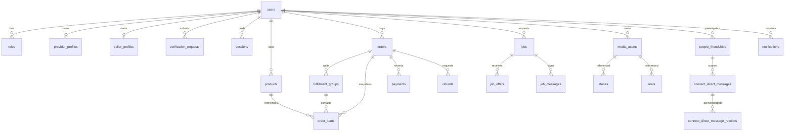

# Data model and ownership

Read-only5November metadata confirms44 public tables, all with RLS, plus12 migration records. This inventory is not a data/restore test. No user/Auth/message/order rows were read and no SQL mutation ran. Source definitions and hosted migration timestamps differ for some previously applied approved migrations; preserve both histories rather than rename applied migrations.

## Current entity relationships

The friendship→message FK is the composite(low_user_id,high_user_id), not independent cross-pair links. Message visibility additionally checks current accepted relationship/revision and block state; the FK alone does not authorize history.

## Domain inventory

| Owner | Existing tables |
|---|---|
| Identity/trust | users, roles, provider_profiles, seller_profiles, sessions, supabase_identities, staff_access, verification_requests, support_reports |
| Commerce/finance | products, orders, order_items, fulfillment_groups, payments, refunds, payment_webhook_events, store_connections, store_oauth_states |
| Services | jobs, job_offers, job_messages |
| Communication | people_friendships, connect_direct_messages, connect_direct_message_receipts, notifications, media_sessions, media_session_members |
| Social/storage | media_assets, people_follows, people_presence, stories, story_views, reels, reel_views, reel_likes |
| Discovery/AI preferences | recommendation_preferences, recommendation_settings, recommendation_signals, recommendation_activity_signals, user_language_preferences |
| Platform | domain_events, audit_logs, rate_limit_buckets, ecovibes_schema_version |

The same44 names are present in checked-in migrations. No organization/member, generic service_request, booking, repair, material-transfer, location or accounting-ledger tables were found in this current baseline. Preserved draft migrations are separate proposals, not hosted schema.

## Important current records

- orders: id,buyer_id,currency,total_minor,status,payment_status,created_at,updated_at.
- order_items: id,order_id,group_id,product_id,product_name,quantity,unit_price_minor,seller_id,variant_id,variant_title. These are purchase snapshots, not live seller price aliases.
- jobs: customer_id, assigned_provider_id, category/title/description/area/budget/currency/timing/scheduled_at/status and timestamps.
- job_offers: job_id,provider_id,amount_minor,note,eta,status,created_at.
- provider_profiles: user_id,verification_state,service_json,revision and business fields. verification_requests target_role/profile_version binds approval.
- payments/refunds remain provider/state records. They are not general ledger postings or balances.
- domain_events currently stores id,aggregate_type,aggregate_id,event_type,actor_id,details_json,created_at. No schema_version/correlation/delivery-ack columns exist yet.

## Transaction and privilege model

API user identity comes from the session, not payload selectors. Existing order transaction validates products, current prices/variants, self-purchase restriction and stock; creates orders/groups/items; then writes notice, domain event and audit. Any failure rolls back. This increment validates the entire input shape and safe quantities before product locks, and locks products in a stable order.

Current anonymous/authenticated database roles have0 direct readable/writable tables. ecovibes_api_runtime has43 readable and43 with at least one write privilege; audit_logs is insert-only in source grants. Broad runtime policies permit the server across accounts, so current account/staff ownership predicates are mandatory. service_role has41 readable/writable tables and BYPASSRLS: never use its browser key or treat it as a replacement for server permission checks.

The first aggregate-grant query guessed an absent ecovibes_api role and failed42704; inspection identified ecovibes_api_runtime and the corrected metadata query succeeded. Nothing was mutated. An initial information-schema FK join yielded a cross product for composite columns; corrected pg_constraint ordinality metadata established the friendship pair. Do not model those false cross pairs.

## Proposed account-cart schema: locally built, not hosted

Generated migration20261105084536 adds commerce_carts(user_id primary/FK,revision,updated_at), commerce_cart_items(user_id/product_id/variant_key composite primary key,quantity), and commerce_order_commands(user_id/client_id primary key, unique user_id/cart_revision,request_hash,order_id,created_at). These reference existing users/products/orders rather than replace them. The44-table hosted inventory above is unchanged.

Cart updates and order creation share one transaction; current actor/session/sellers and cart/product locks protect admission, revisions and reservations. Commands are immutable to the runtime role(SELECT/INSERT only). Anonymous/authenticated/service_role access is explicitly revoked, RLS enabled and runtime operations scoped by explicit policies. The API performs account isolation. This is not a general ledger/outbox or complete retention/privacy implementation.

Migration/compatibility tests must use disposable PostgreSQL; real-account and production approval remain separate. Rollback disables the new actions and retains command/order/cart history; no destructive down migration is proposed.

## Evolution and retention

Preserve existing IDs, relational constraints and migration history. Introduce new optional columns/additive tables only when a real command needs them. Compatibility review must cover current application, proposed code, runtime grants/policies, migration startup marker, rollback and retained security barriers.

Proposed future data:
- Request orchestration references existing job/offer/order IDs and owns only cross-domain request/match/recipient/revision metadata.
- Repair references existing service/product/collection records and condition/evidence status.
- Industrial Exchange requires explicit organizations/membership/verification before agreements/transfer data.
- Outbox references committed aggregate/event IDs; consumer delivery/retry records cannot overwrite financial evidence.
- Financial ledger uses balanced immutable postings and reconciliation references when actually implemented; do not rename payments into a ledger.

Retention must be specified per domain before public enablement: device drafts clear on owner change; private messages follow access/revision rules; location requires short configured expiry/purge; media needs object plus metadata deletion/access handling; financial/audit retention must follow approved obligations and legal review. No universal deletion timer or legal-compliance claim is made here. Backups and media objects require distinct restoration tests.

## Metadata versus behavior

RLS enabled, grants inspected and schema names matched do not prove every policy, tenant boundary or real Auth journey. PG order concurrency, provider money flows, storage durability, deletion, backups/restoration and two-account/device tests remain separate gates. This increment introduces no migration.
