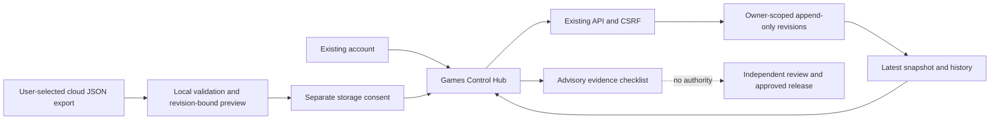

# EcoGames Control Hub integration — 8 November 2026

Status: LOCALLY BUILT. No public publication, production migration, merge, feature activation or deployment is implied.

## Source discovery and preservation

The founder's separate “Create Control Hub” chat and account-owned Tiniest Cloud app were inspected read-only. App slug: ecovibes-games-control-hub--philip. Live version4 and newer draft7 are distinct; this review inspected the current draft source, not production user records. The draft contains a six-collection workboard, test/build/compatibility/submission/change records, a manual evidence checklist, a concept Three.js garage, charts and beginner guidance. It does not establish automatic GitHub/Codex synchronization or successful game publication. No cloud app, account, private record or credential was changed. Historical sign-in links were not reused or retained in source.

The integration reuses its export schema and useful workboard concepts inside the existing EcoVibes Games route. It does not copy the separate app wholesale, add another sign-in system or expose its private data. The old app remains available unchanged. A user can deliberately select/paste an export, inspect the bounded merge and separately consent to storing it in their EcoVibes account. Actual cloud-user-data migration has not been tested.

## Working boundary

The existing React Games hub now hosts Workspace, Device matrix, Open tools and Getting started. Workboard, tests, builds, compatibility, submissions and change notes persist through the existing API under the active account. Each save appends an immutable revision; reads return the latest snapshot and20 revision references. Maximum100 records/128000 UTF-8 bytes and100 revisions per account keep this first pilot bounded. Export is canonical JSON and roundtrips within the same limit.

Imported evidence is user-reported. Even an Approved/Pass/Deployed status remains an untrusted claim. The advisory checklist requires current evidence, owner, timestamp, device and matching project/build tests; it never grants moderation rights, game execution, CI authority, public publication or deployment. No new playable catalog entry is created.

Rumble Rush1 names the preserved prototype in the separate development checkout; this release candidate contains no race implementation. Rumble Rush2 is a separate planned high-fidelity project. Matrix and build evidence remain project-specific. The new increment changes no game scene, controller, model or asset and does not claim AAA quality.

## API and data

- GET /api/v1/games/control: active signed-in owner's latest snapshot/history only.
- PUT /api/v1/games/control: strict expectedOwnerId, revision, operationId and workspace.
- Owner is always taken from the authenticated server context; expectedOwnerId only prevents account-switch retargeting.
- Existing origin/CSRF/rate/error/no-store protections apply.
- Revision compare-and-insert plus owner/operation uniqueness prevents lost writes. Same operation/same payload retries converge; changed payload or stale revision conflicts.
- Browser save is acknowledged only after the server confirms it. Timeout/outage retains the form and retry ID; current visible draft can be exported.
- Import preview is bound to its revision. Refresh invalidates it; loading disables writes; superseded responses cannot replace new state.
- Production migration20261108150000 is additive and UNAPPLIED. Runtime role has SELECT/INSERT only; RLS enabled; public/anon/authenticated/service_role have no direct table access.
- ECOVIBES_GAME_CONTROL_DISABLED=true denies the endpoint while retaining history.
- Empty/unsupported/future account or approval fields are rejected. Evidence URLs are recorded only, never fetched/executed.

## Release and rollback

Before production: prepare a source-only candidate against the reviewed public hub base (exclude unpublished Rumble history), obtain scoped public-source approval if needed, run exact-source remote CI including disposable PostgreSQL and browser journeys, review compatibility, and obtain explicit migration/merge/deploy approval. Apply the exact migration before the application; its schema marker gates access. Missing marker fails this feature closed without preventing the rest of EcoVibes from running.

An app rollback to the previous compatible hub may retain the additive table; do not delete revision data. Disable first if acceptance fails. No production rollback drill has occurred. Hosted Auth, two real owner accounts/devices, actual export import, quota boundary and operational recovery acceptance remain UNVERIFIED. Private-record retention/deletion policy and restoration tooling need a later reviewed increment.

## Still missing

This is the first Control Hub persistence slice, not the full EcoGames platform. Automatic repository/CI synchronization, integrated concept garage/charts, complete beginner tour, creator file Vault, persistent Studio, source editor, Quick Create, Forge, moderation/publishing workflow, owned artifact hosting, collaboration/multiplayer and Rumble Rush2 remain incomplete. Manual claims are never substituted for these capabilities.
