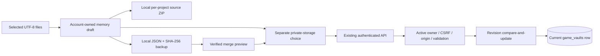

# EcoGames project Vault and text Studio
Status: LOCALLY BUILT. Vault is public draftPR53 with exact prior remote CI; the new folder-preserving source ZIP increment is local-only. ParentPR51/52/53 and their migrations remain unmerged/unapplied; no feature here is deployed.

## Delivered boundary

The existing Games route now has Vault & Studio. A signed-in creator can create a project, write a Story Bible, select individual UTF-8 source files through the browser picker, edit plain text, explicitly consent to private storage, save, reopen, export an integrity-checked JSON backup and restore it after a local preview. No project/source is uploaded by merely selecting a file. Each source remains text: HTML, SVG and scripts are never executed or rendered as documents. Nothing is sent to Chale or another AI provider.

Limits are five projects, twenty text files per project, 32,768 UTF-8 bytes per file, twelve thousand Story Bible characters, three explicit checkpoints per project and 128,000 canonical JSON bytes for the combined Vault. Binary images/audio/video/models, selected-folder import, an isolated game runner, playable-build jobs and public publishing are MISSING here. A Vault JSON backup remains a recovery package. A separate source ZIP preserves one project’s source folders for local-engine import; neither format is a playable build.

Dirty drafts and an ambiguous save operation survive internal Games/App navigation in account-keyed, in-memory context. They do not enter localStorage, sessionStorage, analytics or the shared Chale index. Changing accounts destroys that context. Closing/reloading the app can lose unsaved work; beforeunload warns where supported, but is not a mobile persistence guarantee. Save or export first.

Clean selections refresh from the verified server head, including remote deletion. Dirty drafts retain their original base rather than silently rebasing onto another device's changes. Conflict recovery offers export and an explicit discard-and-reload confirmation. Server acknowledgement alone produces saved feedback. Offline errors and unknown outcomes preserve the draft; matching retries reuse their operation ID.

## Architecture and API

GET /api/v1/games/vault returns only the active authenticated account's current revision, normalized Vault, SHA-256 and server update timestamp. Account selector queries are rejected. No direct browser database grant exists.

PUT accepts exactly expectedOwnerId, revision, operationId, consent='private-storage-v1' and vault. expectedOwnerId is a stale-account guard; the actual owner comes from authenticated server context. Existing CSRF/origin/error/no-store protections apply. Separate per-account buckets allow thirty reads and ten attempted writes per minute; failures/retries count. Neither limit was increased to make tests pass.

A single owner/revision-conditional SQL update saves content and operation receipt together. Concurrent divergent edits produce a conflict; identical retries converge. The last fifty operation receipts retain ID, base revision and payload hash, not raw earlier source. An old receipt retry returns both its acknowledged savedRevision and the actual current head; the client does not replace newer work or claim the current draft was saved. A pruned old operation cannot overwrite a newer head.

IDs are canonical lowercase UUIDs. Relative text paths reject traversal, hidden paths, case collisions and file/directory prefix collisions. Exact field allowlists prevent imported authority/HTML-execution settings. The canonical checksum detects changed content; it does not prove authorship, licence rights, account authorization or an uncompromised server.

## Data, retention and privacy

The new game_vaults table reuses users and the API runtime role. It holds one current row per account with explicit user-controlled source checkpoints, rather than an append-only raw-source history. Removing a file/checkpoint/project removes it from the current payload when the server confirms the update. Operation receipts contain hashes/IDs only. Provider backups, database WAL/physical pages and previously downloaded exports have separate retention; this implementation does not establish physical erasure or a provider backup-restoration drill. Account-wide deletion/retention operations need separate integration.

RLS is enabled; PUBLIC, anon, authenticated and service_role receive no table grants. The existing API runtime receives SELECT/INSERT/UPDATE only and no DELETE/TRUNCATE. Its policies permit API access; owner isolation is enforced by the server's authenticated owner predicate, not a claim that the browser can query arbitrary rows safely.

No user source appears in request/audit content logs or analytics in this increment. The actual local HTTP check inspects captured API output for a synthetic private-source needle. That bounded evidence does not certify all infrastructure logs. No production source/private account data was read or seeded.

## Migration, rollout and rollback

Proposed migration: 20261108210000_game_vault.sql.
SHA-256: 07fb41cafa40c9f0de12746a4bc8969ad17610e377e1563f65a3f7c7f299f45b.
Production: UNAPPLIED.

PR51 Games hub and PR52 Control Hub remain draft/unmerged dependencies. Preserve their reviewed sources. This additive migration coexists with the exact PR52 migration in disposable PostgreSQL; it does not replace identity, workboard or transaction tables.

Before hosted rollout: PR53 source already has scoped public approval and exact remote CI. Its new local source-export delta needs its own publication/CI gate. Review current-main/dependency compatibility, then obtain explicit parent migration/merge/activation/deployment authorization. Set ECOVIBES_GAME_VAULT_DISABLED=true before an approved schema/deployment change. Without the schema marker, or with this deny-only flag, the API returns unavailable. Apply reviewed dependencies in order and verify marker, RLS and grants. A migration alone is not hosted acceptance.

Only an approved pilot should enable the feature after hosted owner/account switching, duplicate/stale/offline saves, backup import/export, device and privacy acceptance. A rollback keeps additive data and disables Vault access, or uses a reviewed compatible app. Do not drop private data as a routine rollback. Production rollback/restore has not been rehearsed.

## Operations, cost and next tasks

No new dependency, provider, inference call, compute instance, paid plan or fee was introduced. Core access remains GH₵0. Existing API/database capacity is reused. Per-account content is bounded at128 KB plus JSONB formatting, receipts, row/index/TOAST/backups and database overhead; total operating cost depends on active accounts and existing plan limits. No additional-service bill or unlimited free-capacity guarantee is implied.

Project memory has no automatic background sync; server reads occur on opening/reloading the feature. Consequential operations are independent of AI. Existing user-reported workboard evidence does not authorize game publication.

| Capability | Current evidence |
| --- | --- |
| Private project/source/Story Bible saves | LOCALLY BUILT; actual isolated API/SQLite/PostgreSQL |
| Checkpoint recovery and integrity JSON backups | LOCALLY BUILT; actual Chrome/API journeys |
| Two-account source and draft isolation | LOCALLY BUILT; synthetic local accounts, not hosted users |
| Parent Vault public PR / remote CI | LOCALLY BUILT public draftPR53; exact692tests/CI verified, unmerged |
| Folder-preserving project source ZIP | LOCALLY BUILT;721tests,14local browser checks and trusted Godot4.7.2 import; new public/CI gate open |
| Production migration, merge, activation, deployment | BLOCKED on explicit approvals and release gates |
| Physical low-end Android/iOS and real Auth acceptance | UNVERIFIED |
| Binary asset storage, isolated runner/playable builds | MISSING; source ZIP is not a packaged game |
| Forge/generation, moderation/publishing and multiplayer | MISSING in this increment |
| AAA Rumble Rush2 | MISSING; separate future native/high-fidelity project |

Next smallest implementation: selected-folder import preserving relative source names, with local preview, existing text/size/path limits and separate save consent. Build/runner isolation, binary storage/retention, licensed assets, CI synchronization and public moderation remain separate gates.

References: the platform's selected-file boundary follows the [browser file input model](https://developer.mozilla.org/en-US/docs/Web/HTML/Reference/Elements/input/file); concurrency reasoning is tested against PostgreSQL and its [transaction isolation contract](https://www.postgresql.org/docs/18/transaction-iso.html). Tests and actual source, rather than diagrams or prompts, define the delivered scope.

## Folder-preserving source ZIP (9 November2026)

One selected project exports its current text source to ecogames-PROJECT-UUID.zip under the same stable root. Dirty source is labeled as a draft and stays unsaved. Story Bible/checkpoints/other projects remain in the separate Vault JSON backup. No download completion, engine build or upload success is inferred from requesting a browser download. Temporary URLs are revoked after30seconds. Previously downloaded source cannot be remotely erased.

The dependency-free STORE writer caps ZIP bytes at140000 and reuses existing normalized project limits. Portable paths reject traversal/absolute/drive/hidden/reserved-device/trailing-dot/whitespace/case-folder aliases. UTF-8 conversion rejects unpaired surrogates rather than losing content. CRC32, regular0644 attributes and deterministic headers are verified by an independent standard-library ZIP reader and actual downloaded archives. The app never launches an external engine or executes project source.

Extract into a new folder and import the existing root project.godot where present. Missing engine configuration, binary assets, packages and scripts are not generated. Trusted synthetic source imported headlessly in official4.7.2 macOS Godot after checksum/Apple-signature verification; other engines/creator projects/native GUI/physical-device acceptance remain UNVERIFIED. Local fixture import is not a gameplay or AAA claim. See docs/releases/2026-11-09-ecogames-project-export-local.md for exact passes, retained REDs, source manifest and release gates.
