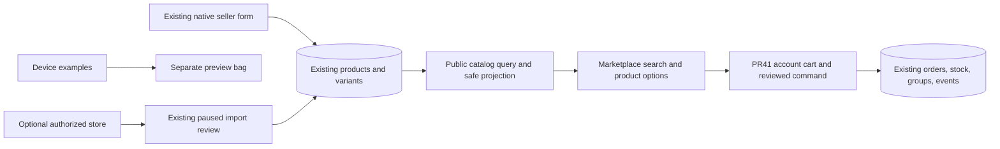

# Marketplace 5.0 implementation audit

5 November 2026; current brief recorded in [directive](../directives/2026-11-05-marketplace-5.md). This source audit builds on the verified architecture baseline and draft PR40/41; neither parent is merged/deployed. No private customer/product/Auth rows were read for this audit. Existing44-table hosted metadata is historical, not a fresh deployment claim.

## Current and target

React MarketplaceHub already has native product entry, CSV, Shopify entry points, a public legacy products array, seller-owned records and account orders. Its default Shop mixes local examples with a separate server stock panel; cloud mapping forces every source to direct and a legacy button directly submits an order. Empty arrays silently stand in for failed loading. Seller tools mix local drafts/server listings and expose an unrelated hardcoded personal name. Supplier prices/stock are illustrative, not verified suppliers.

The new slice makes server records the default, keeps device examples closed behind an explicit control, routes review into PR41's canonical account bag and provides bounded catalog search/pagination. It preserves existing products and local drafts. It adds no product, identity, order or payment table.

## Capability matrix

| Area | State and evidence scope | Remaining gate |
|---|---|---|
| Native seller role/profile | PARTIAL — existing account roles/seller_profiles and forms | Progressive storefront/onboarding, independent review and real seller acceptance |
| Native product create/edit | PARTIAL — existing POST/PATCH, owner checks; synthetic HTTP creates products | Consequential write idempotency/atomic audit coverage, category restrictions, real merchant acceptance |
| Public catalog | LOCALLY BUILT/PARTIAL — new paged read from actual active records | Initial exact646-test/PG/browser CI passed; final-head evidence, review/release and real seller-to-buyer acceptance |
| Categories | PARTIAL — existing free-text category; exact category filtering | Stable hierarchical IDs, attribute schemas and category administration MISSING |
| Dynamic attributes/tags | MISSING | Additive compatible schemas and publish validation; no fake inferred attributes |
| Photos/media | PARTIAL/BLOCKED — owned asset references exist | Production bucket/access/retention approval and actual upload/restart/device acceptance; no new storage here |
| Product sources | PARTIAL — direct/csv/shopify fields already exist; new UI labels actual source | Imported source authority/sync/reconciliation and merchant acceptance |
| Inventory/cart/orders | PARTIAL — existing canonical stock/order transaction and PR41 cart | Parent migration/release, real buyer/seller, fulfillment/provider acceptance |
| Search | LOCALLY BUILT/PARTIAL — bounded literal text, category, seller, source, base-price, stock and keyset sorting | No full-text engine, synonyms/typo tolerance, geo search, attribute ranking or measurable recommendations yet |
| Seller storefronts/reviews | PARTIAL/MISSING — public seller handle/filter, existing verification records | Public storefront/policies, genuine purchase reviews and trust/dispute journey |
| CSV/Excel | PARTIAL — existing CSV flow | Bound file consent/parser/preview/duplicate/import-history hardening; Excel not implemented |
| Shopify | PARTIAL/BLOCKED — existing authorization/import routes; paused review | Configured approved credentials/merchant source test, safe image/sync/writeback acceptance |
| Other connectors/suppliers | MISSING/BLOCKED — examples remain isolated | Official capabilities, actual authorized catalogs and demand; no activation |
| Payments/refunds/settlement | PARTIAL/BLOCKED — existing signed callback/refund primitives | Merchant/provider sandbox, reconciliation/ledger/payout and real-money approvals; no settlement claimed |
| Buyer-seller negotiation | MISSING — accepted-friend/job messages are separate narrower scopes | Product-scoped consent, offer revision and offer-to-order command |
| Chale shopping/listing tools | PARTIAL — existing public search/guidance | New catalog tool reuse/evaluation/confirmation and two-account/private acceptance; no model training here |
| Logistics/Waste/Repair | PARTIAL/BLOCKED | Actual maps/routes, delivery selection, measurements/evidence/payout/disputes and partner acceptance |
| Request Market and innovations | MISSING | Reuse verified products/cart/orders/roles/communications after their gates; no parallel commerce engine |
| Analytics/cost monitoring | PARTIAL/MISSING | No invented sales/views/conversions; no connector cost dashboard in this slice |
| Launch | NOT VERIFIED | Separate internal/Ghana/public gates remain, no public enablement certification |

## Implemented API and ownership

New GET /api/v1/marketplace/catalog accepts one each of q,category,seller,source,minPrice,maxPrice,inStock,sort,limit,cursor,productId. Unknown/private selectors and duplicates fail400. Default12/max24 rows; prices are GHS base prices in integer minor units. Sort is newest/price_low/price_high. Cursor is validated and bound to normalized filters and sort; it is pagination, never authorization.

Only active published non-external GHS listings from active users with current seller membership are returned. Publication is not role-specific verification. No heuristic deletion/quarantine of uncertain products occurs. Safe existing public projection excludes costs, internal seller IDs and private source URLs. Rate limit uses server-trusted peer/account and no search text; generic errors omit query text. ECOVIBES_NATIVE_CATALOG_DISABLED=true denies the new read without changing data.

Schema relationships and order/payment state machines remain those in [data model](../architecture/data-model.md), [contracts](../architecture/contracts.md) and ADR0002. No schema migration is added here; PR41's cart migration remains unapplied. No new durable event bus is needed for read-only discovery. Existing native writes/events still need wider atomic/idempotent acceptance.

## Experience and privacy

Native products, product-list import and optional existing-store connection are ordered clearly. Device examples are closed by default and cannot silently substitute for an API failure. Existing local drafts/bag persist separately. The catalog does not create an order or reserve stock; explicit review opens the account-owned bag. A selected item beyond the legacy100-product window is resolved by its canonical public ID.

Existing native seller actions now capture owner/epoch, clear old private state immediately, validate returned ownership, abort photo reads on account change and ignore stale CSV/results. Three reproduced isolation defects have regression tests. This does not make existing publishing globally idempotent, certify storage, cancel already-committed writes or prove real Auth acceptance.

Search/filter/paging requests have10-second fetch/body deadlines, cancellation/generation/account guards, offline indicators and no private browser persistence. Same-origin owned photo paths use lazy loading; Saver/Extreme require explicit per-photo load. Remote source images are omitted in this slice, not silently fetched. No camera, contacts, microphone, GPS, file-library or AI access is introduced. Existing upload/privacy drafts retain separate gates.

GHS is the current pilot scope, not a permanent Ghana-only product model. Taxonomy, condition, food/cold-chain, vehicles, live animals and regulated/hazardous goods require supported rules and verification before expansion.

## Rollout, compatibility and cost

Stack on PR41; preserve draft40/41 and unrelated dirty root. Existing /marketplace/products array and native writer remain compatible. New query uses current tables/indexes; a schema rewrite is unnecessary. Leading literal substring search is bounded but not a full-text scale claim. Introduce measured indexing/ranking only when needed.

Require exact CI including PostgreSQL SQL/grants and built desktop/narrow UI, independent review and explicit parent/new PR merge/deploy approval. Do not apply PR41 migration by inference. Rollback reverts this UI/read module while preserving parent cart/orders/commands; deny switch provides a read disable. Earlier Auth barrier drafts retain independent rollback rules.

No new package, external API, AI call, paid service, connector subscription, resource or money movement. Existing infrastructure serves reads; usage is still bounded by its current limits. Core EcoVibes platform fees remain GH₵0. Complete operational-cost and provider billing measurement is not implemented.

Next smallest code: category/attribute/publish-policy slice on the existing product model, then safe native photo/import publishing and genuine two-account acceptance. Payment and settlement stay independently gated.
