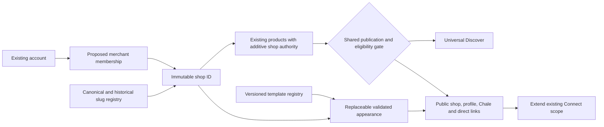

# M01 storefront foundations and integration plan

25 November 2026. Bounded local checkpoint; not an M01 completion or release approval.

## Verified baseline and reuse

GitHub connector resolved main to `d8f02d022cfc6b6ea1fdd88b4089eec37f98822e`. PR44 remains open/draft and depends on the older commerce branch. The local branch is `codex/m01-shop-foundations-20261125`, based on current main, with a separate organizer-folder preview. No existing application path imports these new modules.

Read-only Supabase inspection confirmed existing `users`, user-keyed `seller_profiles`, `products.seller_id`, `people_friendships` and `connect_direct_messages`. No merchant, shop or publication table was returned. Do not mistake a proposed table for an existing production resource.

- `server/index.mjs:106–108`: existing provider/seller profiles and product authority. Extend products, not a second catalogue per template.
- `server/index.mjs:927`: Chale's current public product lookup only checks active/non-external-checkout products. It does not enforce the full proposed publication/moderation/shop/category contract.
- `server/chale-ai.mjs`: reuse the six bounded existing tools and sanitized projections. No storefront write tools are currently registered.
- `server/chale-provider.mjs`: retain operator-controlled replaceable adapters and limits; no model/provider call was made for this preview.
- `server/direct-messages.mjs` and `supabase/migrations/20261027070000_connect_direct_messages.sql`: accepted-friend/revision message authority. Product enquiries need an additive conversation scope; never fabricate friendships or create a separate per-template message service.
- `server/web.mjs`: same-origin static SPA handler. Extensionless paths may return the SPA shell. That does not establish a working public shop route or crawler-ready metadata.
- Existing released Bag guard, private media closure and disabled GPS remain untouched. No payment/order API is used by the new contracts or preview.

## Ownership and dependency graph

The figure describes target ownership/dependency contracts, not independently deployed services. Use the existing modular backend for thousands of logical shops; no app/server per merchant. An editable FigJam copy was created using the connected design tool; the private local evidence records its URL.

## Three independent layers

1. **Identity:** immutable shop UUID and merchant UUID. Existing account IDs become explicitly authorized memberships. Public profile links are opt-in presentation records, not ownership keys. Multiple shops per account and multiple staff per merchant are possible. Display-name changes do not transfer ownership.
2. **Appearance:** template/version, strict schema, allowed palette/type/layout/motion values, approved sections and scoped product references. Theme switching cannot edit catalogue, collections, staff, enquiries or public routes. Separate draft and published versions; an edit invalidates approval.
3. **Routing:** canonical slug plus permanently retained aliases to shop UUID. Unique canonical and historical names, reserved names and transactional collision checks. Alias resolution must never transfer a historical slug to another shop. Only published, active, public shops resolve; no draft route leaks.

Local tests switch a synthetic Life of Kings fixture from The Living Edit to Precision Showroom and back, then compare URL resolution, products, collections, messages, staff and customer-access references. This is contract evidence, not genuine-account or hosted acceptance.

## Single listing authority and automatic discovery

Seller Studio draft -> validation -> authorized publication commit -> existing products authority -> one public eligibility projection -> all eligible public surfaces. Do not require separate Discover submission or copied listings.

`shared/storefront/catalogue.mjs` is the new explicit target projection. It rejects drafts, unpublishing, archival/removal, pending/rejected moderation, hidden/suspended shops, suspended merchants, category ineligibility, ownership mismatch and duplicated listing IDs. It returns only public fields and scoped shop/listing results. Price, description, currency, image reference and availability changes come from the same source object. Theme data is irrelevant to visibility. Maps avoid a per-listing scan of every shop.

**Not integrated yet:** database publication writes, public HTTP/Chale/profile adapters, search indexing and cache invalidation. The existing SQL/public API needs a deliberately reviewed adapter and legacy backfill. Passing a projection unit test does not prove cross-endpoint synchronization.

For the initial small pilot, use authoritative SQL reads rather than introduce a search service. Proposed acceptance: read-after-commit visibility on all uncached public endpoints; no cached content after revocation. If indexing is later added, store source revision and outbox event in the same transaction; retry with bounded backoff, dead-letter inspection and periodic source/index reconciliation. Proposed target p95 <=5 seconds, alert at30 seconds. These are proposed engineering targets, not measured service performance. Only report discoverable after actual public reads and search results verify the same listing revision.

## Implemented files and limitations

| Module | Implemented locally | Integration requirement |
|---|---|---|
| `shared/storefront/design.mjs` | Candidate registry, strict validation, per-shop fallback, detached draft snapshots, comparison/history/undo/restore, local approval invalidation | Server-persisted version IDs, optimistic concurrency, owner approval receipts, migrations for future schema versions |
| `shared/storefront/routing.mjs` | Pure published-shop/alias resolver, reserved-name/collision policy, canonical HTTPS link builder | Unique DB constraints, retained aliases/tombstones, authorized transactional slug writes, HTTP routes |
| `shared/storefront/catalogue.mjs` | One publication/eligibility projection over the listing authority | Shared SQL/read adapters, real publication writes and invalidation |
| `server/commerce/storefront-access.mjs` | Unregistered capability adapter using injected existing-session/current-membership checks | Actual session verification, locked membership queries/RLS and authorized work inside the same transaction; a returned projection is not a reusable authorization token |
| `shared/storefront/tools.d.ts` | Typed future Chale draft/read/review/save/restore request/result seam | Existing tool-dispatch integration, per-operation consent, rate limits, audit, conflict/idempotency handling |
| Four adjacent test files | Contract regressions, isolation, redirects, visibility and draft lifecycle | API, database, crawler, real-account and physical-device tests |

No migrations, provider changes, registration of new API endpoints, production UI changes or checkout actions are included.

## Template library and renderer

The preserved original is **The Living Edit v0.1.0** under the organizer's `Designs/Storefront Design Library/references/the-living-edit/0.1.0/`. Its36 files were copied and SHA-256 matched before extraction. The original `Designs/M01 Marketplace concepts/` remains unchanged.

Reusable local renderer: `Designs/M01 Universal Marketplace/app.mjs`, with `themeBody(shop, theme)`. It composes brand header/hero, collection links, product grid, story and Contact Seller; uses merchant-supplied data and escaped text. It is a preview, not the deployed React renderer. The shared validator file in the preview must remain byte-matched to the branch module.

Candidates: The Living Edit (approved for library preservation/development, no production approval); Everyday Market and Precision Showroom (experimental local compositions, not approved). The same Living Edit configuration schema consumes the real source-reference merchant and a clearly labelled fictional second merchant. A template owns no product or conversation authority.

Suggested application organization: keep `shared/storefront/` and `server/commerce/`; later add renderer components under the existing Marketplace module, not another app/login. Extract the preserved visual components only into that shared renderer after review. Keep the universal Discover shell outside merchant theme scope.

## Proposed data/API changes — not migrated or registered

Reuse `users`, seller profiles, products, Connect, notifications and audit infrastructure. Proposed additive identities: merchants, merchant_memberships, shops, reserved/historical shop_slugs and optional public profile_shop_links. Add products.shop_id plus explicit draft/publication/moderation/category eligibility markers using a reviewed legacy-owner mapping. Reuse relevant PR41–44 classification/media work selectively; do not carry cart/order writers into M01.

Theme drafts/versions reference shop ID and template version, with expected_revision, immutable approved versions and publication audit. Collections/listing-media reference the same shop/listing identity. Draft/temporary preview access is distinct from public visibility.

Proposed routes:
- Public `GET /shop/:slug`, product and collection children; public `GET /api/v1/marketplace/products` and shop projections use the same gate.
- Private `/api/v1/shops/:shopId/...` catalogue/theme/slug operations use real authentication and current capability-scoped membership. Publishing remains a separate owner action.
- Product-linked Connect enquiry submission resolves seller and current listing from the server; client cannot assign recipient authority. Idempotent submission, spam limits, block/report and notification authorization required. No order, stock reservation, Bag clearing or payment call.

## Public domain, sharing, crawler and auth return

Existing verified deployment origin: `https://ecovibes-api.onrender.com`. No evidence establishes control of ecovibes.com. No `/shop/life-of-kings` production route is claimed. The local hash links are design navigation, not public canonical URLs.

Implement one share-target resolver for published shop/listing/collection IDs. It returns server-derived canonical URL/title/description/approved image after eligibility checks. Use Web Share when available, copy fallback otherwise; show truthful failure/cancellation. Generate lightweight QR locally from that verified URL after choosing/reviewing a permitted library; no QR package installed in this increment. Never require social-account connection or auto-post a promotion.

Extend the existing Node web handler to emit escaped server-side canonical/Open Graph/Twitter metadata and appropriate noindex/404 responses before the SPA fallback. Use approved cached share images and genuine publication data. Raw SPA fallbacks and screenshots do not establish social-crawler previews.

Public browsing requires no login. Contact Seller requires existing authentication and a safe server-resolved return target (listing/shop IDs plus action, short expiry, nonce; never an arbitrary redirect URL). Recheck visibility/membership after login. iOS Universal Links/Android App Links require verified domain/app association files and real native builds; they are not implemented by a web URL alone.

## Chale research and integration

Official Shopify Sidekick guidance shows context-aware assistance with review before merchant actions: https://help.shopify.com/en/manual/ai-powered-tools/sidekick/help-and-guidance . Its theme-block workflow previews generated code and supports keep/discard, while warning about generated-code errors: https://help.shopify.com/en/manual/online-store/themes/customizing-themes/theme-editor/sidekick/generate-blocks . EcoVibes should instead accept validated component configuration, never unrestricted generated code. This is an architectural inference, not copied implementation.

Wix's documented brief/variation/manual-refinement flow and explicit preview/publish boundary are useful UX references: https://support.wix.com/en/article/wix-editor-creating-an-ai-generated-site and https://support.wix.com/en/article/wix-harmony-editor-previewing-and-publishing-your-site . Squarespace documents business-guided design and contextual visual refinement: https://www.squarespace.com/design-intelligence . These are public documentation observations, not hands-on certification or dependencies.

Reuse existing Chale orchestration and provider adapters. Add bounded shop-read/draft/validate/preview/compare/save/request-publication/restore tools with independent authorization. The model never supplies actor identity or final publication authority. Imported product text and prompts are untrusted. Explain differences from a validated diff, keep raw private messages out of shared indexes, and require explicit consent before model transmission. Manual editing must survive model failure.

The preview's prompt handler is a small deterministic keyword demonstration. It produces actual validated local renders but is not AI inference. No source images, prompts, catalogue or private records were sent to an inference provider.

Hugging Face connector research found model cards labelled Apache-2.0 for Qwen3-4B-Instruct-2507, Qwen3-VL-4B-Instruct and Qwen3-Embedding-0.6B. These are optional future evaluation candidates, not selected integrations. Model-card capabilities and benchmark claims are publisher assertions, not EcoVibes results. No weights, inference jobs, Spaces, endpoints or GPUs were downloaded/created/run. Open weights do not make hosting free; no Ghanaian language quality or available local capacity was demonstrated. Keep the existing provider/fallback and manual tools. See the private research evidence for exact source excerpts and URLs.

## Cost, accessibility, performance and rollback

No package added or changed. Reused Three.js MIT and existing Lucide ISC notices were inspected. Three.js is optional and lazily loaded (2,120,885 uncompressed module bytes); Balanced/Lite avoid it. Eight photo bytes total399,027. No remote requests are needed after local asset load. Free existing hosting/storage quotas are finite; no claim of infinite free scale. Current production had no media bucket in the retained audit; verify/provision only with the required approval.

Controls have text labels, keyboard access, native dialog semantics and focus styles. Reduced-motion CSS and Lite disable motion; all primary journeys remain DOM-based. Desktop browser emulation is not iPhone/Android/assistive-technology acceptance. Dark platform appearance,200% text, real screen readers, slow-network/image-failure and model-failure/provider isolation still need the appropriate application integration tests. The build retains the pre-existing >500KB chunk warning.

Rollback for this draft: stop importing the unregistered modules or revert this isolated source increment; there are no schema/data mutations to undo. Preserve the already released Bag guard. A future theme release rollback selects a previous validated immutable theme version and invalidates public caches, without reverting shop identity/products/messages or restoring false checkout success.

## Status and next three executable slices

1. Reviewed additive shop/membership/slug schema and transaction adapter with real SQLite/PostgreSQL isolation, revocation and collision tests; explicit migration approval before hosted application.
2. Selective native draft import/publication/media work over existing products; wire one eligibility gate into Discover, shops, profiles, direct links and Chale; verify unpublish and revision propagation before sharing.
3. Extend shared Connect for product enquiries, test two genuine isolated accounts and auth return, then add verified public metadata/share/QR. No durable orders or payments.

The local visual concept needs founder review. Native backend preparation can continue independently. Draft CI is not production approval. M01 remains incomplete until public routing, real source import, persistence and the independent buyer/seller acceptance journey are demonstrated in an authorized environment.
