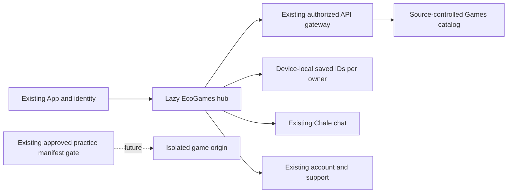

# EcoGames 3.0 — first Games hub increment, 8 November 2026

Status: **LOCALLY BUILT**. Branch `codex/ecogames-hub-20261108`, isolated checkout `/Users/philipkonyah/Documents/ChatGPT/Ecovibes/Builds/EcoGames hub`. Based on freshly verified public main `56e0c2ebf83dfc2c89fccd0bc552691e4ae42b9b`. No publication, merge, migration, enablement or deployment occurred.

## Verified audit and reuse

The current desktop workspace contains a consolidated platform snapshot, not a Git checkout. The original repository and its separate worktrees remain intact. An isolated worktree was created from main; no dirty primary source or prior draft was copied wholesale.

The public main still renders Games inline in App with unconnected challenge/profile/game/notification popups and unsourced community-challenge language. A newer seven-project catalog, searchable component and practice-manifest validator exist in the preserved working snapshot but are absent from main. Reuse the existing catalog/manifest source and tests; this increment replaces the inline screen and adds its missing public GET route.

Stack verified through source/build: React, TypeScript, Vite, existing Node API, shared API client, identity, data-mode preferences, Chale opening event and support/account navigation. SQLite is used only for disposable local HTTP checks. Production PostgreSQL schemas and credentials were not accessed.

Fresh GitHub metadata: main remains PR39; nineteen open PRs #24–32 and #40–50 are drafts with their existing dependency branches. No Games PR is open. Chale PR50 remains separate; its unmerged features are not silently made dependencies of this hub.

Rumble Rush is preserved at `Builds/Rumble Rush`. Its main scene references `res://scripts/main.gd`, which is absent. Existing driving, race-rule, input and graphics helpers exist. Its historical validation failed despite engine process exit zero, including missing script and denied user-data/settings writes. It is **not a verified playable build**. No Godot changes or new exports are claimed.

The 8 November directive explicitly reopens incremental Games work and names preservation of Rumble Rush. Earlier Rumble African research/Gate A documents remain historical and are not treated as approval to publish, rename or finish that separate proposal.

## Actual code

- Lazy-loaded EcoGames hub with graphite surfaces, an original vector Accra Skyway illustration, responsive project cards and reduced-motion styling. No remote artwork, video autoplay, WebGL allocation or paid asset generation. Extreme Saver omits the hero image request.
- Discover / Saved projects / Creator guide navigation; real category/search filtering, no-match recovery, accessible project details, focus entry and return.
- Shared API client reads the existing source-controlled public development catalog. Strict client validation rejects malformed/duplicate/released records rather than running unreviewed games.
- Device-local saved IDs, partitioned by account or guest. Persist only after confirmed storage write; quota failure does not display success. Corrupt storage is preserved and controls disabled. Matching other-tab storage changes refresh the list. This is **not** cloud sync, a downloaded game library, creator project storage or backup.
- Existing Chale chat and support/account entry points work. Creator text does not pretend to generate, approve, build or publish games.
- Read-only `GET /api/v1/games?q=&category=`; validated filters, thirty requests per minute per existing network limiter. Public records contain no account data, executable URLs, fake ratings, player counts, earnings or released builds. Existing private-route protections stay in place.
- Existing manifest validation retains independent approved-release matching, integrity/expiry checks and separate-origin/practice-only constraints. This validator is preparation, not an operational launcher.

No dependency, identity, database, migration, permission, model, quota, fee or provider setting changed.

## Validation and retained failures

Use pinned Node26.12.1, built-in Undici8.12.2 / development Undici8.12.3, Vite8.3.5. System runtime unchanged. No test deadline, assertion scope, worker or isolation relaxation.

Commands:
- `node node_modules/vitest/vitest.mjs run src/modules/navigation.test.ts src/modules/App.navigation.test.tsx`
- `node node_modules/vitest/vitest.mjs run server/games.test.mjs src/modules/games/GamesHub.test.tsx`
- `node node_modules/vitest/vitest.mjs run`
- `npm run build`
- `node scripts/test-games-http.mjs`
- `node scripts/test-games-browser.mjs`
- `node scripts/test-dependency-security.mjs`
- `npm audit --json`

Baseline navigation18 passed. Initial TDD RED: two missing-module suites, zero tests collected. First implementation49 passed/1 failed on the saved-button accessible name; corrected focused50 passed before two additional corrupt-storage/cross-tab checks. Initial build failed for an unsupported Testing Library option and unused import; both fixed. First HTTP/browser probes failed at fixture startup and encoded-space filesystem path; both fixed, original logs retained. Next HTTP probe exposed an incorrect checker expectation (404 instead of the existing guarded401), corrected without changing authorization. First full run616/617 passed; sole failure was the old Gaming heading expectation after the intentional EcoGames rename. The route contract and accessible heading were corrected.

Final regression: **617/617 passed across45files in154.15seconds**, including38server Games and14UI checks. Final production TypeScript/build and repeated exact API/browser checks passed. Results and hashes are recorded in `work/ecogames-20261108/checkpoint.json`. Existing CI now executes the new HTTP/browser checks; their reporting directory is created on a clean checkout and Chrome selection supports the existing Linux CI. Remote CI has not run for this new source.

Actual HTTP API: nine groups passed, including empty/search/category results, malformed/duplicate/unsupported query denial, anonymous write/launch/upload denial, private inbox401 and rate limit429. Disposable database removed after checking.

Built-app installed Chrome/macOS:320/768/1024/1440px journeys passed with no overflow/page errors, decoded original art, discover/saved navigation, save/reload, filter/reset, focus entry/return and existing Chale opening.390px Extreme Saver made zero artwork requests; loaded catalog and explicit local save worked offline. Desktop1440 and narrow320 screenshots were actually inspected. These are browser checks with unrelated API failures, not real phones, live accounts, native apps, controllers or hosted acceptance.

Dependency audit reports zero vulnerabilities; eight existing local HTTP security assertions passed. Existing main/Communications chunk warnings remain. No broad security certification is claimed. Historical QA001 and unrelated failed attempts remain undiagnosed.

## Architecture and privacy boundary

A saved preference does not authorize a game, upload or cloud synchronization. No unpublished project/source/story is uploaded or indexed. No new device permission, background task, third-party tracking or AI training occurs. Generated code will require isolated execution and explicit publication review in a later increment.

## Cost, rollout and recovery

Additional activated expenditure: GH₵0. No hosting, GPU, paid API or new provider was activated. Artwork2653bytes; current lazy JS/CSS artifact sizes and checks are recorded with the build. No FPS, battery or low-end-device benchmark is claimed.

Before release: independent exact-diff review, scoped public-source approval if required, exact remote CI, explicit merge/release authorization, green main CI and hosted/real-device checks. Public game releases remain unavailable. No migration is needed; reverting this app-only change to main preserves unrelated domain data. Saved-list keys can remain on the device without being read by the older app. No production rollback drill occurred.

## Ordered implementation backlog

| Increment | Evidence/status | Next dependency |
| --- | --- | --- |
|0 audit | Existing main/working snapshot, drafts, Godot failure and tools inspected | Retain current receipts |
|1 premium hub | LOCALLY BUILT; actual local API, saved discovery and browser journeys | Independent review / exact CI / authorized release |
|2 playable race and isolated launcher | BROKEN / MISSING | Restore missing main.gd; validate a complete race and real export; approved isolated game origin and controls |
|3 Personal Game Vault | MISSING | Atomic local project persistence, separate manifests, storage/quota, import/export/recovery/checkpoints; not this saved list |
|4 Vibe Studio | MISSING | Real saved projects, scoped Chale inputs and reviewed edits; existing Chale stays independent |
|5 Quick Create | MISSING | Editable Godot project, real build/playtest and follow-up same-project edit |
|6 Story Bible | MISSING | Per-project persistent canon, versioned proposals, mission graph and actual objective test |
|7 3D Forge | MISSING / UNVERIFIED resources | Verified tool/model licenses and hardware; actual mesh/rig/GLB/import/control evidence |
|8 director / health | MISSING | Actual build/test/asset evidence, transparent criteria, no invented percentages |
|9 publishing | MISSING | Private builds, reviewed immutable manifests, channels, isolation and save-compatible rollback |
|10 device/controller lab | UNVERIFIED | Physical compatible hardware and measured gameplay performance |
|11 community / multiplayer | MISSING | Genuine sessions, permissions, abuse controls; no unapproved always-on infrastructure |
|12 evaluation / model updates | MISSING | Curated lawful data, controlled evaluation and separate model-change approval |
|13 expansion | DEFERRED | Pilot evidence and completed foundations |

Next smallest code task: recover Rumble Rush's missing main controller in an isolated copy using its existing driving/race/input modules, then headless-import and actual graphical race/checkpoint/finish/restart tests before any public launcher. Preserve older Rumble African references and the original Godot folder.

The full EcoGames directive, including the later platform ambitions, is retained separately. Milestone1 does not fulfill those later capabilities. Core EcoVibes launch fees remain GH₵0.
